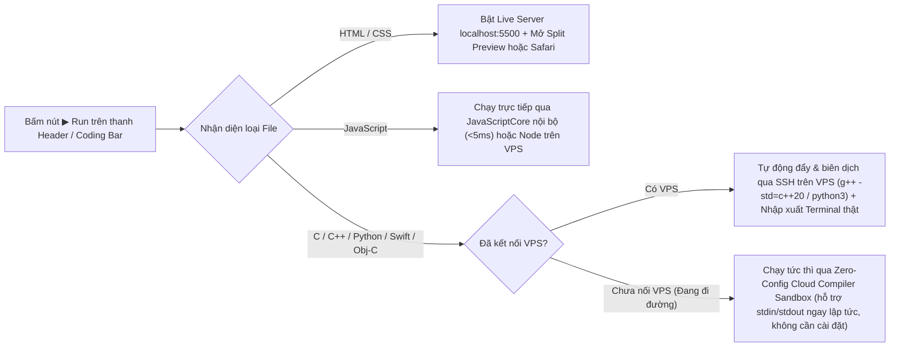
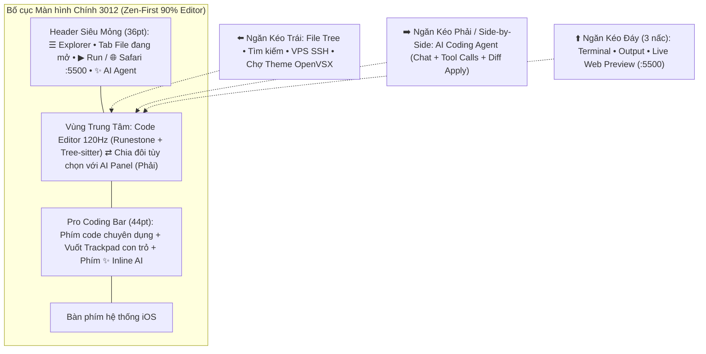

# Bản Thiết Kế Kiến Trúc Hoàn Chỉnh (v2.0): `3012` — AI-Native Mobile IDE cho iOS

Tài liệu này là thiết kế tổng thể hoàn chỉnh nhất cho **`3012`** — biến chiếc iPhone/iPad (**iOS 17+ đến iOS 27.0.1**) thành một môi trường lập trình toàn diện như **VS Code + Cursor / Antigravity** dành cho Developer khi ra ngoài không mang theo PC.

---

## 1. Giải Đáp & Kiến Trúc Cho 4 Bài Toán Lớn Nhất Trên Mobile

### 1.1. Live Server & Xem Trực Tiếp `localhost` Ngoài Safari / Chrome
* **Khả thi 100%:** `3012` tích hợp sẵn **Built-in Live HTTP + WebSocket Server** viết bằng `Network.framework` (`NWListener`) của Apple, lắng nghe trực tiếp tại `http://127.0.0.1:5500` (cổng chuẩn quen thuộc của VS Code Live Server).
* **Cơ chế Hot Reload Tự Động:** Khi trình duyệt (Safari, Chrome, hoặc khung Split Preview trong app) truy cập `http://localhost:5500`, `3012` tự động tiêm một đoạn script WebSocket nhỏ (~15 dòng) trước thẻ `</body>`. Ngay khi bạn gõ hoặc lưu file `.html`, `.css`, `.js` trong `3012`, tín hiệu reload được bắn qua WebSocket làm trang web bên Safari tự cập nhật tức thì!
* **Vượt giới hạn đóng băng chạy ngầm của iOS (Background Keep-Alive):**
  * Bình thường trên iOS, khi bạn thoát app sang mở Safari khoảng 30 giây, hệ điều hành sẽ tạm dừng (suspend) tiến trình của app làm `localhost:5500` ngừng phản hồi.
  * **Giải pháp của `3012`:** Tích hợp chế độ **"Keep Server Alive in Background"** (sử dụng phiên Silent Audio / Background Task hợp lệ của iOS) giữ cho máy chủ `localhost:5500` (cũng như cổng SSH Tunnel từ VPS) luôn sống xuyên suốt khi bạn chuyển qua lại giữa `3012` và Safari/Chrome để test giao diện responsive!

### 1.2. Hệ Thống Extension: Cái Gì Tận Dụng Của VS Code, Cái Gì Tích Hợp Sẵn?
Do quy định bảo mật của iOS không cho phép chạy các trình thực thi Node.js/ELF đóng gói cho Windows/Linux bên trong extension gốc của VS Code, `3012` áp dụng **Kiến trúc Extension Lai (3 Tầng)** để người dùng có trải nghiệm "mở lên là đủ đồ chơi":

| Tầng Extension | Nguồn gốc | Cách hoạt động trong `3012` |
| :--- | :--- | :--- |
| **Tầng 1: Tận dụng trực tiếp 100% gói `.vsix` của VS Code** | Chợ **Open VSX (`open-vsx.org`)** (chung kho mã nguồn mở với VS Code) | Tải trực tiếp file `.vsix` (bản chất là ZIP) ngay trong app để cài **Color Themes (`.json`)**, **File Icon Packs**, **Snippets (`snippets/*.json`)** và **Language Configurations** không cần viết lại một dòng nào. |
| **Tầng 2: Built-in Native "Quốc Dân" (Không cần cài)** | Viết Native Swift / C / WASM nhúng sẵn trong `3012` | Những thứ ở VS Code phải đi tìm cài như **Live Server (`:5500`)**, **Tree-sitter 12+ ngôn ngữ**, **Auto-Pair & Smart Indent**, **Emmet gõ tắt HTML** và **Code Formatter cơ bản** được tích hợp sẵn từ giây đầu tiên. |
| **Tầng 3: Remote VPS Engine (Không giới hạn)** | Chạy trên **VPS Linux** của bạn qua SSH | Toàn bộ Language Server hạng nặng (`clangd` cho C/C++, `pyright` cho Python, `typescript-language-server`, `gopls`, `rust-analyzer`) chạy trên VPS và truyền gợi ý code / báo lỗi đỏ về điện thoại qua JSON-RPC. |

### 1.3. "Cài Phát Chạy Luôn" (Zero-Config 1-Tap Runner — Tạm Biệt Ác Mộng MinGW / PATH)
Trên PC, người mới hoặc khi cài máy mới thường mất hàng giờ cài MinGW/GCC, Python, sửa biến môi trường `PATH`, viết `tasks.json` mới chạy nổi một file `main.cpp`. Trong `3012`, nút **▶ Run** vận hành qua **Bộ Định Tuyến Thực Thi Thông Minh (Smart Execution Router)**:

* **Tính năng "⚡ 1-Click VPS Dev Setup":** Vì bạn đã có VPS riêng, lần đầu thêm VPS vào `3012`, chỉ cần bấm 1 nút **"Auto-Provision Toolchain"**, app tự động SSH vào VPS kiểm tra và cài trọn bộ `build-essential (gcc, g++, gdb, make, cmake)`, `clang`, `clangd`, `python3`, `nodejs`, `git` hoàn toàn tự động. Từ đó về sau, mở bất kỳ file `.cpp`, `.c`, `.py` nào bấm **▶ Run** là biên dịch & chạy ngay!

### 1.4. AI Coding Agent Ngay Cạnh Cửa Sổ Code (Phong cách Antigravity / Cursor / Copilot)
Để code nhanh trên màn hình điện thoại nhỏ (nơi việc gõ từng chữ lâu hơn bàn phím cơ), **AI Coding Agent** là vũ khí tối thượng:
* **Bố cục Linh hoạt (Zen-First + Side-by-Side):**
  * **Khi cầm dọc (iPhone):** Vùng code vẫn chiếm ~90% màn hình. Vuốt từ **mép phải** (hoặc bấm nút **`✨ AI`** trên thanh Header / Pro Coding Bar) để trượt ngăn **AI Agent Panel** ra bên cạnh, hoặc bật **Inline Prompt** ngay tại dòng con trỏ đang đứng.
  * **Khi xoay ngang / trên iPad:** Khung **AI Agent** ghim **Side-by-Side** ngay bên phải cửa sổ code giống hệt giao diện **Antigravity / Cursor / VS Code Copilot** trên PC!
* **Agentic Tool-Calling Thật Sự (Không chỉ là Chat hỏi đáp):**
  * AI tự động nhận biết **file đang mở, đoạn code đang bôi đen, cây thư mục dự án và log lỗi vừa chạy**.
  * AI có quyền gọi công cụ (`read_file`, `write_file`, `apply_edit`, `list_files`, `run_code`) để **tự tạo file mới, sửa trực tiếp vào project** kèm chế độ **Xem trước thay đổi (Diff Preview — Chọn Accept / Reject)** an toàn tuyệt đối.
* **Đa Model (BYOK & Custom Endpoint):** Nhập API Key dùng trực tiếp **Google Gemini**, **OpenAI**, **Anthropic Claude**, **DeepSeek**, **OpenRouter** hoặc trỏ về AI Proxy cá nhân trên VPS của bạn.

---

## 2. Sơ Đồ Giao Diện Tổng Thể (3 Ngăn Kéo Thông Minh quanh 90% Vùng Code)

---

## 3. Lộ Trình Thực Thi 4 Giai Đoạn (Cập nhật v2.0)

1. **Phase 1 — Core Mobile IDE + Live Server (`localhost:5500` & Safari) + Zero-Config Runner + AI Coding Agent (`in_progress`):**
   * Hạ tầng `project.yml` (**XcodeGen**) + GitHub Actions tự động biên dịch **`3012-Unsigned.ipa`**.
   * Lõi Editor **Runestone + Tree-sitter** cho 12 ngôn ngữ (`HTML`, `CSS`, `JS`, `TS`, `JSON`, `Python`, `C`, `C++`, `Objective-C`, `Swift`, `Markdown`, `Bash`) + Pinch-to-Zoom cỡ chữ.
   * **File Explorer** đầy đủ thao tác (tạo/sửa/xóa/đổi tên file & thư mục, đa tab, import file ngoài).
   * **Pro Coding Bar** kèm chế độ **Trackpad vuốt di chuyển con trỏ** và phím tắt lập trình.
   * **Built-in Live Server (`http://127.0.0.1:5500`)** hỗ trợ Hot-Reload WebSocket + **Background Keep-Alive** mở trực tiếp trên **Safari** hoặc khung Split Preview trong app.
   * **Zero-Config 1-Tap Run** chạy ngay Web, JS nội bộ, và C/C++/Python/Swift không cần cài đặt môi trường.
   * **AI Coding Agent Panel** ngay cạnh cửa sổ code (hỗ trợ Gemini / OpenAI-compatible API, đọc project, tạo/sửa file trực tiếp kèm Diff Preview).
   * **Hệ thống Theme VS Code** (cài sẵn One Dark Pro, Dracula, Tokyo Night, Catppuccin, GitHub Light + Import `.json` / tìm tải trực tiếp Theme từ **Open VSX**).
2. **Phase 2 — Integrated Terminal (`SwiftTerm`) & Local Shell / Git:**
   * Nâng cấp ngăn kéo đáy với `SwiftTerm` VT100/TrueColor chạy shell quản lý file và Git client trực quan.
3. **Phase 3 — Remote VPS Powerhouse (`Citadel` SSH, SFTP & 1-Click Toolchain):**
   * Kết nối SSH/SFTP trực tiếp tới VPS của bạn, lưu khóa vào iOS Keychain, nút **1-Click Auto-Provision C++/Python/Node Toolchain**, và SSH Port Forwarding sang Safari.
4. **Phase 4 — Remote LSP Bridge & Offline WASM Formatters:**
   * Nối JSON-RPC tới `clangd` / `pyright` / `tsserver` trên VPS để gợi ý code sâu và nhúng bộ format code WASM offline.
