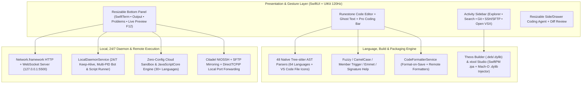

<div align="center">
  <p>
    
  </p>
  <p><strong>Native Code Editor, Remote Development Workstation &amp; Agentic IDE for iOS and iPadOS</strong></p>

  <p>
    <a href="README.md">Tiếng Việt</a> |
    <strong>English</strong> |
    <a href="README.zh-CN.md">简体中文</a> |
    <a href="README.ja.md">日本語</a> |
    <a href="README.ko.md">한국어</a> |
    <a href="README.ru.md">Русский</a> |
    <a href="README.es.md">Español</a>
  </p>

  <p>
    <a href="https://github.com/userlethekhoi/3012/actions/workflows/build-ipa.yml">
      
    </a>
    <a href="https://github.com/userlethekhoi/3012/releases/latest">
      
    </a>
    <a href="https://github.com/userlethekhoi/3012/releases/latest/download/3012-Unsigned.ipa">
      
    </a>
    
    
    <a href="LICENSE">
      
    </a>
  </p>
</div>

---

## Overview

**3012** (`com.dev.app3012`) is a 100% native Integrated Development Environment (IDE) for **iOS 15.0+** and **iPadOS 15.0+**, built with `SwiftUI` and `UIKit` to deliver a desktop-class **VS Code** and **Cursor** workflow on mobile hardware without Electron or WebView overhead.

Its editor core runs directly on `Runestone` backed by **48 statically compiled C/C++ `Tree-sitter` AST parsers** for 120Hz ProMotion scrolling. Out of the box, 3012 ships with a local `localhost:5500` Live Server, an **on-device 24/7 background daemon & Telegram bot runner**, a **Theos Tweak** (`.deb`/`.dylib`) builder, **xtool Studio** (SwiftPM `.ipa` packaging & Mach-O `.dylib` injection), a full `SwiftTerm` (`xterm-256color`) terminal, **SSH/SFTP** remote development via `Citadel`, and an autonomous **Coding Agent** with inline Diff Review.

---

## Download & Installation

Every push to `main` is automatically compiled via GitHub Actions on `macos-15` (Xcode 16+) and published as **`3012-Unsigned.ipa`** under **Releases** (ad-hoc signed for immediate compatibility with **TrollStore on iOS 15/16+** as well as `.p12` sideloaders).

- **Direct Download (Latest):** [**3012-Unsigned.ipa**](https://github.com/userlethekhoi/3012/releases/latest/download/3012-Unsigned.ipa)
- **All Releases & SHA-256 Checksums:** [GitHub Releases](https://github.com/userlethekhoi/3012/releases)

### Installation Guide (`.p12` / TrollStore / Sideload)

| Installer | Requirement | Steps |
| :--- | :--- | :--- |
| **TrollStore** | CoreTrust-supported iOS 15.0+ – 17.0 | Open `3012-Unsigned.ipa` directly in TrollStore for permanent installation without re-signing. |
| **Feather / ESign / GBox** | Personal `.p12` certificate + `.mobileprovision` | Import your certificate into the signing app, select `3012-Unsigned.ipa`, and tap **Sign & Install**. |
| **AltStore / SideStore** | Personal Apple ID (Free or Paid) | Open `3012-Unsigned.ipa` from **My Apps (+)** to automatically sign and schedule refreshes. |
| **Sideloadly (macOS / Windows)** | Apple ID or Developer Certificate | Drag and drop `3012-Unsigned.ipa` into Sideloadly and install over USB or Wi-Fi. |

---

## System Architecture



---

## Core Features

### 1. 120Hz Native Editor, 64 Languages, Tab Strip & Resizable Split Views
- **48 compiled `Tree-sitter` parsers** with a 3-tier language detector (special filenames like `Dockerfile`, `Makefile`, `Package.swift`, `xtool.yml`, `Tweak.x`; **145+ extensions**; and shebang/header inspection) plus **VS Code Seti language file icons** across the file tree and tabs.
- Supports 64 languages across Systems (`C`, `C++`, `Rust`, `Go`, `Zig`, `Objective-C`, `Logos`), Web (`HTML`, `CSS`, `SCSS`, `JS`, `TS`, `TSX`, `Vue`, `Svelte`, `Astro`), Mobile (`Swift`, `Dart`, `Kotlin`, `Java`), Scripting (`Python`, `PHP`, `Ruby`, `Lua`, `Elixir`), and Config/Infra (`SQL`, `JSON`, `YAML`, `TOML`, `Makefile`, `CMake`, `Terraform`).
- **Dedicated VS Code Tab Strip:** Newly opened tabs appear on the left; supports tab pinning (`Pin Tab`), reopen closed tab (`Cmd + Shift + T`), and opening external files, folders, or `.zip` archives directly from the iOS **Files** app with two-way `NSFileCoordinator` sync.
- **Resizable Split Panes:** Drag-to-resize dividers (double-tap to reset) for the Bottom Console/Live Preview, Right AI Agent Drawer, and Markdown + Mermaid Split View.
- **Pro Coding Accessory Bar:** Two-row accessory bar with a haptic **Trackpad** for character-accurate cursor/selection control, repeatable arrow keys, **Flick Keys** for brackets/operators, `Tab` for Ghost Text acceptance, one-tap Undo/Redo/Copy/Paste, and **Pinch-to-Zoom** font sizing.

### 2. Smart IntelliSense, Inline Ghost Text, Auto-Format & Diagnostics
- **VS Code-Grade IntelliSense (`CodeIntelligenceService`):**
  - **Fuzzy Subsequence** & **CamelCase / `snake_case`** matching (`gEBI` -> `getElementById`, `umap` -> `std::unordered_map`).
  - Zero-character completion triggers after `.`, `->`, `::`, `#include <`; embedded `<style>` CSS & `<script>` JS completion inside HTML/Vue/Svelte; built-in **Emmet** (`!`, `div.card`, `ul>li*3`); dimmed inline **Ghost Completion** (tap ghost text or press `Tab`); and **Signature Help**.
  - Dedicated autocomplete for **Theos Logos** (`%hook`, `%orig`, `%ctor`, `MSHookFunction`), **`xtool.yml`**, and **`Package.swift`**, plus **Symbol Outline**, Breadcrumbs, and inline **Find & Replace** (`Cmd + F`).
- **Code Formatting (`CodeFormatterService`):** **Format-on-Save / Format-on-Run** (`Cmd + Shift + F`) using remote VPS formatters (`clang-format`, `gofmt`, `rustfmt`, `black`, `prettier`, `swift-format`...) or the offline comment/string-aware formatter (preserving `\t` indentation in `Makefile` and `Go`).
- **Inline Diagnostics:** Real-time error/warning highlights directly in `Runestone` linked to the **Problems** tab and one-tap **Fix with Agent**.

### 3. VS Code Working-Tree File Status Colors (`U` / `A` / `M` / `D`)
| Badge | Status | Color | Meaning |
| :---: | :--- | :--- | :--- |
| **`U`** | Untracked | Green (`#73C991`) | Newly created file in the workspace. |
| **`A`** | Added Code | Green (`#73C991`) | Existing file with newly added lines or code blocks. |
| **`M`** | Modified | Amber (`#E2C08D`) | Existing file modified in-place. |
| **`D`** | Deleted | Red (`#F14C4C` + strikethrough) | Deleted file kept visible in its original folder with a **1-Tap Restore** button. |

### 4. Built-in Live Server (`127.0.0.1:5500`) & 24/7 On-Device Daemon / Bot Runner
- **Live Server `:5500` & Mobile Web DevTools (`F12`):** `Network.framework` HTTP + WebSocket server with automatic **Hot-Reload** when saving `.html`/`.css`/`.js`, openable in **Safari** or **Split Preview** with live `console.log`/`error` capture, JS Eval, and responsive viewports (`390px`, `768px`, `1280px`).
- **24/7 On-Device Daemon & Telegram Bot (`LocalDaemonService`):**
  - Keeps `localhost:5500`, active SSH PTY connections, and background scripts alive when switching apps or turning off the screen (`AVAudioSession` silent playback loop + `beginBackgroundTask` + `NWPathMonitor`).
  - **1-Tap Telegram Bot Scaffolder** with `.env` token storage, local `.js` daemon execution (`fetch`, `setInterval`, `fs`, `process.deviceStatus()` reading device battery/network), Python bot handler adapter, multi-PID live console logs, and automatic restart on transient errors.

### 5. On-Device iOS Development: `xtool` Studio & Theos Tweak Builder (`.deb` / `.dylib`)
- **xtool Studio (`XtoolBuildService`):**
  - One-tap templates for SwiftPM + `xtool.yml` (`SwiftUI App`, `SwiftUI App + Widget`, `Host App + .dylib`), bi-directional `Package.swift` ⇄ `xtool.yml` sync, and compilation via SSH VPS or GitHub Actions.
  - **On-Device Mach-O `.dylib` Injector:** Unpacks `.ipa` archives locally, injects `.dylib` binaries into `Payload/<App>.app/Frameworks/`, patches 64-bit / Fat Mach-O headers (`LC_LOAD_DYLIB`), edits `CFBundleIdentifier` / `CFBundleDisplayName`, and repacks unsigned `.ipa` files without a Mac.
- **Theos Tweak & Mod Menu Builder (`TheosBuildService`):**
  - Scaffolds **Logos Tweaks** or **Floating Mod Menu HUDs**, auto-scans source files into `Makefile` (`_FILES`), and supports **`rootless` / `roothide` / `rootful`** packaging.
  - Compiles `.deb` and `.dylib` outputs via 3 modes: Docker-isolated Build Server, personal SSH VPS, or offline `.zip` + GitHub Actions export.

### 6. Zero-Config Execution, `SwiftTerm` & Remote SSH / SFTP (`Citadel`)
- **Zero-Config 1-Tap Run (`Cmd + R`):** Runs **30+ languages** (C, C++20, Rust, Go, Java, C#, Python, Swift, Zig, PHP, Ruby, Lua, SQL, Haskell...) or prioritizes remote VPS compilers when connected via SSH.
- **`SwiftTerm` (`xterm-256color`) Terminal:**
  - Offline: Built-in shell supporting UNIX & Windows commands (`ls`/`dir`, `cd`, `cat`, `grep`, `tree`, `git`, `zip`/`unzip`, `curl`, `bg`, `ps`, `logs`, `keepalive`, `xtool`, `claude`, `opencode`).
  - Connected to VPS: Automatically switches to a real **Interactive Linux SSH PTY** (`vim`, `tmux`, `htop`, `pip3`, `gcc`, `gdb`).
- **SSH, SFTP & Port Forwarding:** Credentials stored in **iOS Keychain** (with sandbox fallback for TrollStore installs without Keychain entitlements), 1-tap **Ed25519** keypair generator, live SFTP browsing/editing, 1-click VPS toolchain installer, and **Local Port Forwarding (`localhost:<port>` ⇄ `VPS:<port>`)**.

### 7. Agentic Coding Assistant, Theme Studio, Open VSX & 7 App Languages
- **User-Configured AI Coding Agent:** Bring your own API keys for OpenAI, Anthropic Claude, Google Gemini, DeepSeek, OpenRouter, xAI Grok, Groq, Mistral, Qwen, Z.ai GLM, local LAN **Ollama / LM Studio**, or **Apple On-Device** (iOS 26+). Supports SSE streaming, live `/models` discovery, and **Diff Preview (`Accept & Save` / `Reject`)**.
- **Theme Studio & Open VSX (`.vsix`):** Includes 14+ dark/light themes, custom syntax color editor, and direct `.vsix` package installation from **Open VSX** for Color Themes & Snippets.
- **7 Built-in UI Languages:** Switch seamlessly between `Tiếng Việt`, `English`, `简体中文`, `日本語`, `한국어`, `Русский`, and `Español`.

---

## Privacy

- **Zero Telemetry:** 3012 contains no analytics, tracking SDKs, or ads, and operates no intermediary proxy servers.
- **Credential Storage:** API keys, VPS passwords, SSH private keys, and GitHub tokens remain on-device in **iOS Keychain** (or scoped sandbox storage when sideloaded without Keychain entitlements).
- **External Requests:** When using online AI providers or the optional community Theos Build Server, requests go directly to your configured provider/server (with explicit consent before the first community build).

---

## Hardware Keyboard Shortcuts (Magic Keyboard / Bluetooth)

| Shortcut | Action |
| :--- | :--- |
| `Cmd + S` | Save active file, auto-format (if enabled), and create a timeline snapshot |
| `Cmd + Shift + F` | Format current document according to its language |
| `Cmd + R` | Smart Run current file/project (`Live Server` / `Sandbox` / `Theos` / `xtool` / `SSH`) |
| `Cmd + P` | Open Command Palette & Quick Open |
| `Cmd + F` / `Cmd + G` | Toggle inline Find & Replace / Jump to next match (`Ctrl + G`: Go to Line) |
| `Cmd + /` | Toggle language-aware line comment |
| `Cmd + N` / `Cmd + O` | Create new file / Open file from iOS Files |
| `Cmd + W` / `Cmd + Shift + T` | Close active tab / Reopen last closed tab |
| `Cmd + B` / `Cmd + I` / `Cmd + J` | Toggle Left Sidebar / Right AI Agent Panel / Bottom Terminal Panel |
| `Opt + ↑` / `Opt + ↓` | Move current line or selection up / down |
| `Tab` | Accept top `Smart IntelliSense` or `Ghost Completion` suggestion |

---

## Build from Source

Targets, frameworks, and SPM packages are declared in [`project.yml`](project.yml) via **XcodeGen**.

### Prerequisites
- macOS 15.0+ with **Xcode 16.0+**
- [**XcodeGen**](https://github.com/yonaskolb/XcodeGen) (`brew install xcodegen`)

### Building `3012-Unsigned.ipa`

```bash
# 1. Clone the repository
git clone https://github.com/userlethekhoi/3012.git
cd 3012

# 2. Generate Xcode project from project.yml
xcodegen generate

# 3. Resolve Swift Package Manager dependencies
xcodebuild -resolvePackageDependencies -project App3012.xcodeproj -scheme App3012

# 4. Build Release for iOS 15.0+ (arm64)
xcodebuild build \
  -project App3012.xcodeproj \
  -scheme App3012 \
  -configuration Release \
  -sdk iphoneos \
  -derivedDataPath build \
  IPHONEOS_DEPLOYMENT_TARGET=15.0 \
  CODE_SIGN_IDENTITY="" \
  CODE_SIGNING_REQUIRED=NO \
  CODE_SIGNING_ALLOWED=NO \
  AD_HOC_CODE_SIGNING_ALLOWED=YES

# 5. Ad-hoc sign (TrollStore compatible) & package 3012-Unsigned.ipa
mkdir -p Payload
cp -R build/Build/Products/Release-iphoneos/3012.app Payload/
codesign --force --deep --sign - --timestamp=none Payload/3012.app
zip -qry 3012-Unsigned.ipa Payload
```

---

## Project Structure

```text
3012/
├── .github/workflows/
│   ├── build-ipa.yml                   # Automated CI/CD pipeline building 3012-Unsigned.ipa for Releases
│   └── build-server.yml                # CI verification for the isolated Docker Theos Build Server
├── BuildServer/                        # Self-hostable Docker-isolated Theos build server
├── Config/
│   └── AppIcon.svg                     # Source vector icon
├── Resources/
│   └── Brand/
│       ├── 3012-banner.svg             # Horizontal vector banner
│       ├── 3012-icon.svg               # Master vector brand icon
│       └── 3012-icon.png               # High-resolution squircle icon
├── Sources/
│   ├── App/
│   │   └── App3012Main.swift           # App entry point, Tab Strip, resizable split bars & IDE coordinator
│   ├── Models/
│   │   ├── AIProviderModels.swift      # AI provider profiles, presets & model ranking
│   │   ├── AppLocalization.swift       # 7-language localization & iOS 15+ compatibility wrappers
│   │   ├── EditorThemeModel.swift      # Syntax palettes, VS Code JSON importer & editor preferences
│   │   └── WorkspaceModels.swift       # 64 languages, Tree-sitter mapping & U/A/M/D diff status
│   ├── Resources/
│   │   └── Assets.xcassets/            # Complete iOS/iPadOS AppIcon set
│   ├── Services/
│   │   ├── AIAgentService.swift        # Agent profiles, Terminal AI CLI & Diff patch applicator
│   │   ├── AIProviderClient.swift      # Model discovery & SSE streaming (OpenAI, Claude, Gemini, Apple On-Device)
│   │   ├── CodeFormatterService.swift  # Multi-language formatter (Offline + remote VPS)
│   │   ├── CodeIntelligenceService.swift # Smart IntelliSense, Ghost Text, Emmet & Inline Diagnostics
│   │   ├── CodeRunnerService.swift     # Zero-Config execution router for 30+ languages
│   │   ├── ExtensionStoreService.swift # Open VSX API client & .vsix installer (ZIPFoundation)
│   │   ├── FileTimelineAndArchiveService.swift # 20-snapshot local history & .zip import/export
│   │   ├── GitService.swift            # Local VCS baseline, GitHub REST Clone/Push & Remote Git
│   │   ├── KeychainVault.swift         # iOS Keychain + TrollStore fallback storage & Ed25519 keygen
│   │   ├── LiveServerService.swift     # HTTP + WebSocket Live Server (:5500) with Hot-Reload
│   │   ├── LocalDaemonService.swift    # 24/7 on-device background runtime, Keep-Alive & Telegram Bot Adapter
│   │   ├── SSHWorkspaceService.swift   # Citadel SSH/SFTP, VPS toolchain setup & Port Forwarding
│   │   ├── TheosBuildService.swift     # Theos Tweak / Mod Menu scaffolding & .deb/.dylib compilation
│   │   ├── WorkspaceManager.swift      # File tree, external Files picker, tabs, pinning & search
│   │   └── XtoolBuildService.swift     # xtool Studio, Package.swift/xtool.yml sync & Mach-O .dylib injector
│   └── Views/
│       ├── Components/IDEVectorIcons.swift # VS Code Seti language icons & native vector icons
│       ├── Editor/
│       │   ├── ProCodingAccessoryBar.swift # Two-row accessory bar, haptic Trackpad & Flick Keys
│       │   └── RunestoneEditorView.swift   # 120Hz UIKit Runestone bridge, Ghost Text & HighlightedRange
│       ├── Panels/
│       │   ├── AIAgentSidePanel.swift      # Streaming AI chat sidebar & Diff preview sheet
│       │   ├── AIProviderSettingsSheet.swift # Provider profiles, Keychain API keys & model selector
│       │   ├── BottomConsolePreviewPanel.swift # Terminal, Output, Problems & Live Preview DevTools
│       │   ├── CommandPaletteSheet.swift   # Command Palette & Quick Open
│       │   ├── LocalDaemonManagerSheet.swift # 24/7 On-Device Daemon & Telegram Bot manager
│       │   ├── MarkdownMermaidPreviewView.swift # Live Markdown & Mermaid renderer
│       │   ├── SwiftTermTerminalContainer.swift # Xterm-256color SwiftTerm, SSH PTY & Local Shell
│       │   ├── SymbolAndTimelineSheets.swift # Symbol Outline, Timeline, Theme Studio & Language Picker
│       │   ├── TheosBuilderSheet.swift     # Theos Tweak / Mod Menu UI
│       │   └── XtoolBuilderSheet.swift     # xtool Studio & on-device .ipa/.dylib injector UI
│       ├── Settings/SettingsAndThemesSheet.swift # Editor preferences, themes, fonts & app language
│       └── Sidebar/LeftExplorerDrawer.swift # 5-tab Activity Sidebar (Explorer, Search, Git, SSH, Open VSX)
├── LICENSE                             # GNU Affero General Public License v3.0
├── NOTICE                              # Third-party attributions & copyright notice
└── project.yml                         # XcodeGen project & SPM dependency specification
```

---

## Copyright, Authorship & License (GNU AGPLv3)

**Copyright (c) 2026 Le The Khoi (GitHub: [@userlethekhoi](https://github.com/userlethekhoi) • Telegram: [@coder_009](https://t.me/coder_009)).**

The source code, architecture, and brand assets of **3012** are licensed under the [**GNU Affero General Public License v3.0 (AGPL-3.0)**](LICENSE).

### Mandatory Terms for Forks, Redistribution & Derivative Works

1. **Attribution & Copyright Notice:**
   - Retain all original copyright notices (`Copyright (c) 2026 Le The Khoi`), the [`LICENSE`](LICENSE) file, and clear attribution to [`github.com/userlethekhoi/3012`](https://github.com/userlethekhoi/3012).
   - Removing author credits or claiming original ownership is strictly prohibited.
2. **Disclose Full Source Code:**
   - Anyone who forks, modifies, redistributes binaries (`.ipa`), or operates a modified version over a network (AGPL-3.0 Section 13) **must publicly release the complete corresponding source code** including all modifications and build scripts at no charge.
3. **Same License (`AGPL-3.0`):**
   - All forks and derivative works must remain licensed under **GNU AGPLv3**; closed-source/proprietary relicensing is not permitted.
4. **State Changes:**
   - Modified source files must carry prominent notices documenting changes made.

> **Trademark & Commercial Licensing:** The **3012** name and brand assets under `Resources/Brand/` belong to the original author; independent forks must clearly state they are derived from **3012**. Proprietary commercial licensing outside `AGPL-3.0` requires written permission from [@userlethekhoi](https://github.com/userlethekhoi).
