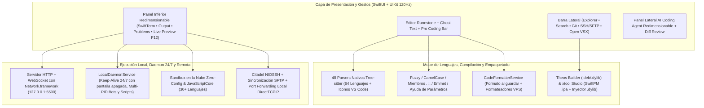

<div align="center">
  <p>
    
  </p>
  <p><strong>Editor de Código Nativo, Estación de Desarrollo Remoto e IDE Agéntico para iOS y iPadOS</strong></p>

  <p>
    <a href="README.md">Tiếng Việt</a> |
    <a href="README.en.md">English</a> |
    <a href="README.zh-CN.md">简体中文</a> |
    <a href="README.ja.md">日本語</a> |
    <a href="README.ko.md">한국어</a> |
    <a href="README.ru.md">Русский</a> |
    <strong>Español</strong>
  </p>

  <p>
    <a href="https://github.com/userlethekhoi/3012/actions/workflows/build-ipa.yml">
      
    </a>
    <a href="https://github.com/userlethekhoi/3012/releases/latest">
      
    </a>
    <a href="https://github.com/userlethekhoi/3012/releases/latest/download/3012-Unsigned.ipa">
      
    </a>
    
    
    <a href="LICENSE">
      
    </a>
  </p>
</div>

---

## Descripción General

**3012** (`com.dev.app3012`) es un entorno de desarrollo integrado (IDE) 100% nativo para **iOS 15.0+** e **iPadOS 15.0+**, construido directamente con `SwiftUI` y `UIKit` para ofrecer el flujo de trabajo de **VS Code** y **Cursor** en dispositivos móviles sin WebView ni Electron.

El núcleo de edición utiliza `Runestone` junto con **48 analizadores sintácticos `Tree-sitter` en C/C++ compilados estáticamente** para un desplazamiento a 120Hz ProMotion. Incluye de serie un Live Server local en `localhost:5500`, **daemon en segundo plano 24/7 en el dispositivo para bots de Telegram y scripts**, compilador de **Theos Tweak** (`.deb`/`.dylib`), **xtool Studio** (empaquetado `.ipa` con SwiftPM e inyección de `.dylib` en Mach-O), terminal `SwiftTerm` (`xterm-256color`), cliente **SSH/SFTP** con `Citadel` y un **Coding Agent** con revisión de Diff en línea.

---

## Descarga e Instalación

Cada actualización en la rama `main` se compila automáticamente en GitHub Actions (`macos-15` / Xcode 16+) y se publica como **`3012-Unsigned.ipa`** en **Releases** (con firma ad-hoc compatible directamente con **TrollStore en iOS 15/16+** y herramientas de firma `.p12`).

- **Descarga directa (Última versión):** [**3012-Unsigned.ipa (Latest Release)**](https://github.com/userlethekhoi/3012/releases/latest/download/3012-Unsigned.ipa)
- **Todas las versiones y sumas SHA-256:** [GitHub Releases](https://github.com/userlethekhoi/3012/releases)

### Guía de instalación (TrollStore / `.p12` / Sideload)

| Herramienta | Requisitos | Pasos |
| :--- | :--- | :--- |
| **TrollStore** | iOS 15.0+ – 17.0 compatible con CoreTrust | Abre `3012-Unsigned.ipa` directamente en TrollStore para instalar de forma permanente sin renovar firma. |
| **Feather / ESign / GBox** | Certificado personal `.p12` + `.mobileprovision` | Importa tu certificado en la app de firma, selecciona `3012-Unsigned.ipa` y pulsa **Sign & Install**. |
| **AltStore / SideStore** | Apple ID personal (Gratuito o de pago) | Abre `3012-Unsigned.ipa` desde **My Apps (+)** para firmar y programar renovaciones automáticas. |
| **Sideloadly (macOS / Windows)** | Apple ID o certificado de desarrollador | Arrastra `3012-Unsigned.ipa` a Sideloadly e instala por USB o Wi-Fi. |

---

## Arquitectura del Sistema



---

## Características Principales

### 1. Editor Nativo 120Hz, 64 Lenguajes, Pestañas VS Code y Vistas Divididas Ajustables
- **48 parsers `Tree-sitter` compilados** con detección en 3 niveles (nombres especiales como `Dockerfile`, `Makefile`, `Package.swift`, `xtool.yml`, `Tweak.x`; más de **145 extensiones**; e inspección de `shebang`), mostrando **iconos de archivo estilo VS Code Seti** en el árbol y las pestañas.
- Compatibilidad con 64 lenguajes: Sistemas (`C`, `C++`, `Rust`, `Go`, `Zig`, `Objective-C`, `Logos`), Web (`HTML`, `CSS`, `SCSS`, `JS`, `TS`, `TSX`, `Vue`, `Svelte`, `Astro`), Móvil (`Swift`, `Dart`, `Kotlin`, `Java`), Scripting (`Python`, `PHP`, `Ruby`, `Lua`, `Elixir`) y Config/Infra (`SQL`, `JSON`, `YAML`, `TOML`, `Makefile`, `CMake`, `Terraform`).
- **Barra de pestañas estilo VS Code:** permite fijar pestañas (`Pin Tab`), reabrir la última pestaña cerrada (`Cmd + Shift + T`) y abrir archivos sueltos, carpetas o archivos `.zip` externos desde la app **Archivos** con sincronización bidireccional mediante `NSFileCoordinator`.
- **Paneles divididos redimensionables:** arrastra los divisores (doble toque para restablecer) en la Consola/Vista Previa inferior, el panel derecho del AI Agent y la vista dividida de Markdown + Mermaid.
- **Pro Coding Accessory Bar:** barra de doble fila con **Trackpad** háptico para mover el cursor o seleccionar texto, flechas con repetición al mantener pulsado, **Flick Keys** para símbolos/operadores, tecla `Tab` para Ghost Text, Undo/Redo/Copy/Paste en un toque y **Pinch-to-Zoom**.

### 2. Smart IntelliSense, Ghost Text en Línea, Auto-Formato y Diagnósticos
- **IntelliSense nivel VS Code (`CodeIntelligenceService`):** coincidencia **Fuzzy** y **CamelCase / `snake_case`** (`gEBI` -> `getElementById`, `umap` -> `std::unordered_map`), disparo instantáneo tras `.`, `->`, `::`, `#include <`, contexto `<style>`/`<script>` en HTML/Vue/Svelte, **Emmet** integrado, **Ghost Completion** atenuado en línea, soporte para **Theos Logos** (`%hook`, `%orig`) y **`xtool.yml`/`Package.swift`**, **Symbol Outline** y **Buscar y Reemplazar** (`Cmd + F`).
- **Formateador de código (`CodeFormatterService`):** Format-on-Save / Format-on-Run (`Cmd + Shift + F`) mediante herramientas en VPS (`clang-format`, `gofmt`, `rustfmt`, `black`, `prettier`) o el formateador local sin conexión (preservando `\t` en `Makefile` y `Go`).
- **Diagnósticos en línea:** resalta errores y advertencias directamente en el editor junto con la pestaña **Problems** y corrección en un toque con el Agent.

### 3. Colores de Estado de Archivos estilo VS Code (`U` / `A` / `M` / `D`)
| Etiqueta | Estado | Color | Significado |
| :---: | :--- | :--- | :--- |
| **`U`** | Untracked | Verde (`#73C991`) | Archivo nuevo en el espacio de trabajo. |
| **`A`** | Added Code | Verde (`#73C991`) | Archivo existente con nuevas líneas o bloques añadidos. |
| **`M`** | Modified | Ámbar (`#E2C08D`) | Archivo modificado en sus líneas existentes. |
| **`D`** | Deleted | Rojo (`#F14C4C` + tachado) | Archivo eliminado, visible en su ruta original con botón **Restaurar en 1 toque**. |

### 4. Live Server Integrado (`127.0.0.1:5500`) y Daemon 24/7 en el Dispositivo
- **Live Server `:5500` y Web DevTools móvil (`F12`):** servidor HTTP + WebSocket sobre `Network.framework` con **Hot-Reload** automático al guardar `.html`/`.css`/`.js`, vista en **Safari** o Split Preview con captura de `console.log`/`error`, evaluación JS y tamaños responsivos (`390px`, `768px`, `1280px`).
- **Daemon 24/7 en el dispositivo y Bot de Telegram (`LocalDaemonService`):** mantiene `localhost:5500`, sesiones SSH PTY y scripts activos incluso con la pantalla bloqueada o al cambiar de app (`AVAudioSession` silencioso + `beginBackgroundTask` + `NWPathMonitor`). Incluye creador de Bot de Telegram en 1 toque con `.env`, ejecución de scripts `.js` (`fetch`, `setInterval`, `fs`, `process.deviceStatus()`), adaptador para bots Python, gestión multi-`PID`, reinicio automático tras errores y logs en vivo.

### 5. Desarrollo iOS Local: `xtool` Studio y Theos Tweak Builder (`.deb` / `.dylib`)
- **xtool Studio (`XtoolBuildService`):** plantillas SwiftPM + `xtool.yml`, sincronización bidireccional `Package.swift` ⇄ `xtool.yml`, compilación vía SSH VPS o GitHub Actions e **inyector local de `.dylib` en `.ipa`** (desempaqueta `.ipa`, inserta `.dylib` en `Frameworks/`, parchea cabeceras Mach-O 64-bit / Fat `LC_LOAD_DYLIB`, edita `CFBundleIdentifier` y reempaqueta sin necesidad de Mac).
- **Theos Tweak & Mod Menu Builder (`TheosBuildService`):** genera **Logos Tweaks** o **Mod Menu HUD flotante**, escanea archivos para `Makefile` (`_FILES`), soporta **`rootless` / `roothide` / `rootful`** y compila mediante Build Server Docker, VPS SSH personal o exportación `.zip` con GitHub Actions.

### 6. Ejecución Zero-Config, Terminal `SwiftTerm` y SSH / SFTP (`Citadel`)
- **Zero-Config Run (`Cmd + R`):** ejecuta más de **30 lenguajes** sin configuración manual o prioriza el compilador remoto si hay conexión SSH.
- **Terminal `SwiftTerm` (`xterm-256color`):** shell local con comandos UNIX y Windows (`ls`/`dir`, `cd`, `cat`, `grep`, `tree`, `git`, `zip`/`unzip`, `curl`, `bg`, `ps`, `logs`, `keepalive`, `xtool`, `claude`, `opencode`) que cambia automáticamente a **Linux SSH PTY** real (`vim`, `tmux`, `htop`, `pip3`, `gcc`, `gdb`) al conectar a un VPS.
- **SSH, SFTP y Port Forwarding:** almacenamiento en **iOS Keychain** (con respaldo seguro en sandbox para entornos TrollStore sin entitlement), generador **Ed25519** en 1 toque, edición remota SFTP con subida al guardar e instalador de toolchain VPS en 1 clic junto con **Port Forwarding local (`localhost:<port>` ⇄ `VPS:<port>`)**.

### 7. AI Coding Agent, Theme Studio, Open VSX y 7 Idiomas
- **AI Coding Agent configurable:** conecta OpenAI, Anthropic Claude, Google Gemini, DeepSeek, OpenRouter, xAI Grok, Groq, Mistral, Qwen, Z.ai GLM, servidores LAN **Ollama / LM Studio** o **Apple On-Device** (iOS 26+), con streaming SSE, descubrimiento de modelos vía `/models` y **Diff Preview (`Accept & Save` / `Reject`)**.
- **Theme Studio y Open VSX (`.vsix`):** más de 14 temas oscuros y claros, editor de colores de sintaxis e instalación directa de `.vsix` desde **Open VSX**.
- **7 Idiomas de Interfaz:** `Tiếng Việt`, `English`, `简体中文`, `日本語`, `한국어`, `Русский`, `Español`.

---

## Privacidad

- **Sin telemetría:** 3012 no incluye SDKs de analítica, rastreadores ni publicidad, y no opera servidores proxy intermediarios.
- **Credenciales locales:** las claves API, contraseñas VPS, claves SSH y tokens de GitHub permanecen en el dispositivo dentro de **iOS Keychain** (o almacenamiento aislado en sandbox).

---

## Atajos de Teclado Físico (Magic Keyboard / Bluetooth)

| Atajo | Acción |
| :--- | :--- |
| `Cmd + S` | Guardar archivo, formatear automáticamente y crear punto en el historial |
| `Cmd + Shift + F` | Formatear el documento según su lenguaje |
| `Cmd + R` | Ejecución inteligente (`Live Server` / `Sandbox` / `Theos` / `xtool` / `SSH`) |
| `Cmd + P` | Abrir paleta de comandos y búsqueda rápida de archivos |
| `Cmd + F` / `Cmd + G` | Buscar y reemplazar / Siguiente coincidencia (`Ctrl + G`: Ir a línea) |
| `Cmd + /` | Alternar comentario de línea según el lenguaje |
| `Cmd + N` / `Cmd + O` | Nuevo archivo / Abrir archivo desde Archivos de iOS |
| `Cmd + W` / `Cmd + Shift + T` | Cerrar pestaña actual / Reabrir última pestaña cerrada |
| `Cmd + B` / `Cmd + I` / `Cmd + J` | Mostrar/ocultar barra izquierda / AI Agent / terminal inferior |
| `Opt + ↑` / `Opt + ↓` | Mover línea o bloque seleccionado arriba / abajo |
| `Tab` | Aceptar sugerencia de `Smart IntelliSense` o `Ghost Completion` |

---

## Compilar desde el Código Fuente

La configuración de compilación y dependencias SPM se definen en [`project.yml`](project.yml) para **XcodeGen**.

```bash
git clone https://github.com/userlethekhoi/3012.git
cd 3012
xcodegen generate
xcodebuild -resolvePackageDependencies -project App3012.xcodeproj -scheme App3012

xcodebuild build \
  -project App3012.xcodeproj \
  -scheme App3012 \
  -configuration Release \
  -sdk iphoneos \
  -derivedDataPath build \
  IPHONEOS_DEPLOYMENT_TARGET=15.0 \
  CODE_SIGN_IDENTITY="" \
  CODE_SIGNING_REQUIRED=NO \
  CODE_SIGNING_ALLOWED=NO \
  AD_HOC_CODE_SIGNING_ALLOWED=YES

mkdir -p Payload
cp -R build/Build/Products/Release-iphoneos/3012.app Payload/
codesign --force --deep --sign - --timestamp=none Payload/3012.app
zip -qry 3012-Unsigned.ipa Payload
```

---

## Derechos de Autor y Licencia (GNU AGPLv3)

**Copyright (c) 2026 Le The Khoi (GitHub: [@userlethekhoi](https://github.com/userlethekhoi) • Telegram: [@coder_009](https://t.me/coder_009)).**

El código fuente, la arquitectura y los recursos de marca de **3012** se distribuyen bajo la licencia [**GNU Affero General Public License v3.0 (AGPL-3.0)**](LICENSE). Todo fork, modificación, redistribución de binarios (`.ipa`) o uso en red como servicio (Sección 13 de AGPL-3.0) debe conservar los avisos de copyright originales y el archivo [`LICENSE`](LICENSE), y **publicar íntegramente el código fuente correspondiente bajo la misma licencia `AGPL-3.0`**.
