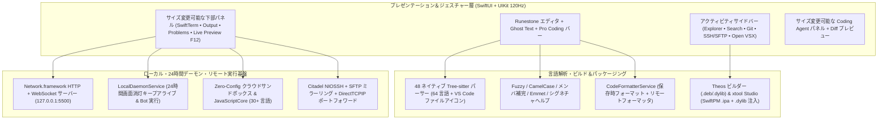

<div align="center">
  <p>
    
  </p>
  <p><strong>iOS・iPadOS 向けネイティブコードエディタ、リモート開発ワークステーション＆AI コーディング IDE</strong></p>

  <p>
    <a href="README.md">Tiếng Việt</a> |
    <a href="README.en.md">English</a> |
    <a href="README.zh-CN.md">简体中文</a> |
    <strong>日本語</strong> |
    <a href="README.ko.md">한국어</a> |
    <a href="README.ru.md">Русский</a> |
    <a href="README.es.md">Español</a>
  </p>

  <p>
    <a href="https://github.com/userlethekhoi/3012/actions/workflows/build-ipa.yml">
      
    </a>
    <a href="https://github.com/userlethekhoi/3012/releases/latest">
      
    </a>
    <a href="https://github.com/userlethekhoi/3012/releases/latest/download/3012-Unsigned.ipa">
      
    </a>
    
    
    <a href="LICENSE">
      
    </a>
  </p>
</div>

---

## 概要

**3012**（`com.dev.app3012`）は、**iOS 15.0+** / **iPadOS 15.0+** 向けに `SwiftUI` と `UIKit` のみで設計されたネイティブ統合開発環境（IDE）です。WebView や Electron に頼らず、モバイル端末上で **VS Code** や **Cursor** に匹敵するコーディング体験を実現します。

エディタ中核には `Runestone` と **48 言語の静的コンパイル済み C/C++ `Tree-sitter` AST パーサー**を採用し、120Hz ProMotion スクロールに対応。さらにローカル Web サーバー（`localhost:5500`）、**端末内 24 時間常駐デーモン＆Telegram Bot ランナー**、**Theos Tweak**（`.deb`/`.dylib`）ビルダー、**xtool Studio**（SwiftPM `.ipa` ビルド＆Mach-O `.dylib` インジェクター）、`SwiftTerm`（`xterm-256color`）ターミナル、`Citadel` **SSH/SFTP** クライアント、Diff プレビュー付き **Coding Agent** を標準搭載しています。

---

## ダウンロード＆インストール

`main` ブランチへの更新ごとに GitHub Actions（`macos-15` / Xcode 16+）が自動でビルドを行い、**Releases** に **`3012-Unsigned.ipa`** を公開します（iOS 15/16+ の **TrollStore** や `.p12` 署名ツールでそのまま使える Ad-hoc 署名済み）。

- **最新版を直接ダウンロード：** [**3012-Unsigned.ipa (Latest Release)**](https://github.com/userlethekhoi/3012/releases/latest/download/3012-Unsigned.ipa)
- **リリース一覧＆SHA-256 チェックサム：** [GitHub Releases](https://github.com/userlethekhoi/3012/releases)

### インストール手順（TrollStore / `.p12` / サイドロード）

| ツール | 必要な環境 | 手順 |
| :--- | :--- | :--- |
| **TrollStore** | CoreTrust 対応の iOS 15.0+ – 17.0 | `3012-Unsigned.ipa` を TrollStore で直接開くだけで永続インストール（再署名不要）。 |
| **Feather / ESign / GBox** | 個人 `.p12` 証明書 + `.mobileprovision` | アプリに証明書を読み込み、`3012-Unsigned.ipa` を選択して **Sign & Install**。 |
| **AltStore / SideStore** | 個人 Apple ID（無料 / 有料） | **My Apps (+)** から `3012-Unsigned.ipa` を開き、署名・自動更新を実行。 |
| **Sideloadly (macOS / Windows)** | Apple ID または Developer 証明書 | `3012-Unsigned.ipa` をドラッグ＆ドロップして USB / Wi-Fi 経由でインストール。 |

---

## システムアーキテクチャ



---

## 主な機能

### 1. 120Hz ネイティブエディタ・64 言語対応・VS Code スタイルタブ＆可変スプリット
- **48 種の C/C++ ネイティブ `Tree-sitter` パーサー**に加え、特殊ファイル名（`Dockerfile`、`Makefile`、`Package.swift`、`xtool.yml`、`Tweak.x`）、**145 以上の拡張子**、Shebang を判定する 3 段階認識を搭載。**VS Code Seti 準拠の言語別ファイルアイコン**をツリーとタブに表示します。
- Systems（`C`、`C++`、`Rust`、`Go`、`Zig`、`Objective-C`、`Logos`）、Web（`HTML`、`CSS`、`SCSS`、`JS`、`TS`、`TSX`、`Vue`、`Svelte`、`Astro`）、Mobile（`Swift`、`Dart`、`Kotlin`、`Java`）、Scripting（`Python`、`PHP`、`Ruby`、`Lua`、`Elixir`）、Config/Infra（`SQL`、`JSON`、`YAML`、`TOML`、`Makefile`、`CMake`、`Terraform`）まで 64 言語を網羅。
- **専用タブストリップ＆外部ファイル連携：** タブ固定（`Pin Tab`）、閉じたタブの再オープン（`Cmd + Shift + T`）、iOS **ファイル**アプリからの単一ファイル・フォルダ・`.zip` インポート（自動展開＆`NSFileCoordinator` 双方向同期）に対応。
- **ドラッグ可能なスプリットパネル：** 下部ターミナル／プレビュー、右側 AI Agent パネル、Markdown + Mermaid 分割表示の比率をドラッグで調整できます（ダブルタップでリセット）。
- **Pro Coding Accessory Bar：** 触覚フィードバック付き **Trackpad**、長押しリピート対応矢印キー、上フリックで記号を入力できる **Flick Keys**、`Tab` で確定する Ghost Text、Undo/Redo/Copy/Paste ボタン、**ピンチ操作でのフォント拡大縮小**を備えています。

### 2. Smart IntelliSense・インライン Ghost Text・自動フォーマット・リアルタイム診断
- **VS Code 品質の補完（`CodeIntelligenceService`）：** Fuzzy 検索＆CamelCase/スネークケース略語（`gEBI` -> `getElementById`、`umap` -> `std::unordered_map`）、`.`/`->`/`::`/`#include <` 直後の即時補完、HTML/Vue/Svelte 内の `<style>`・`<script>` コンテキスト判定、**Emmet**（`!`、`div.card`、`ul>li*3`）、薄く表示されるインライン **Ghost Completion**、**Theos Logos**（`%hook`、`%orig`）および **`xtool.yml`/`Package.swift`** 補完に対応。
- **コードフォーマット（`CodeFormatterService`）：** 保存時／実行時の自動整形（`Cmd + Shift + F`）に対応し、リモート VPS 上の `clang-format` / `gofmt` / `rustfmt` / `black` / `prettier` やオフライン整形エンジン（`Makefile` と `Go` の `\t` を保持）を利用できます。
- **インライン診断（`Inline Diagnostics`）：** エディタ行のエラーハイライト、**Problems** タブへのジャンプ、ワンタップでの **AI 修正提案**に対応。

### 3. VS Code 準拠のファイル変更ステータス（`U` / `A` / `M` / `D`）
| バッジ | 状態 | 表示色 | 意味 |
| :---: | :--- | :--- | :--- |
| **`U`** | Untracked | 緑 (`#73C991`) | ワークスペースに新規作成されたファイル |
| **`A`** | Added Code | 緑 (`#73C991`) | 既存ファイルに行またはコードブロックが追加された状態 |
| **`M`** | Modified | アンバー (`#E2C08D`) | 既存行のみが編集された状態 |
| **`D`** | Deleted | 赤 (`#F14C4C` + 取り消し線) | 削除済みファイル（元の場所に表示され **1 タップ復元**が可能） |

### 4. 内蔵 Live Server（`127.0.0.1:5500`）＆ 端末内 24 時間常駐デーモン / Bot 実行
- **Live Server `:5500`＆ モバイル F12 DevTools：** `Network.framework` 製の HTTP + WebSocket サーバー。`.html`/`.css`/`.js` 保存時に自動 **Hot-Reload** し、Safari や Split Preview 上でコンソールログ収集、JS Eval、レスポンシブ切替（`390px` / `768px` / `1280px`）が可能です。
- **端末内 24 時間キープアライブ＆Telegram Bot（`LocalDaemonService`）：** 無音 `AVAudioSession` 再生ループ + `beginBackgroundTask` + `NWPathMonitor` により、画面オフや他アプリへの切り替え後も `localhost:5500`、SSH PTY、常駐スクリプトが iOS に停止されません。`.env` 付き **1 タップ Telegram Bot 生成**、`.js` スクリプト実行（`fetch`、`setInterval`、`fs`、`process.deviceStatus()`）、Python Bot アダプター、マルチ `PID` ログ表示、エラー時自動再起動を搭載。

### 5. 端末完結 iOS 開発：`xtool` Studio ＆ Theos Tweak ビルダー（`.deb` / `.dylib`）
- **xtool Studio（`XtoolBuildService`）：** SwiftPM + `xtool.yml` テンプレート生成、`Package.swift` ⇄ `xtool.yml` 双方向同期、SSH VPS / GitHub Actions ビルドに対応。さらに端末内で `.ipa` を展開し、`Payload/<App>.app/Frameworks/` への `.dylib` 追加、64-bit / Fat Mach-O ヘッダの `LC_LOAD_DYLIB` パッチ、`CFBundleIdentifier` 編集、未署名 `.ipa` 再パッケージまで Mac なしで完結します。
- **Theos Tweak / Mod Menu ビルダー（`TheosBuildService`）：** **Logos Tweak** や **フローティング Mod Menu HUD** をワンタップ生成し、`Makefile` の `_FILES` 自動スキャン、`rootless` / `roothide` / `rootful` パッケージングに対応（Docker 隔離ビルドサーバー / SSH VPS / オフライン `.zip` + GitHub Actions）。

### 6. Zero-Config 実行・`SwiftTerm` ターミナル・SSH / SFTP（`Citadel`）
- **Zero-Config Run（`Cmd + R`）：** 30 以上の言語を端末から直接実行でき、SSH 接続中は VPS 側のコンパイラを優先使用します。
- **`SwiftTerm`（`xterm-256color`）：** オフライン時は UNIX / Windows 互換ローカルシェル（`ls`/`dir`、`cd`、`cat`、`grep`、`tree`、`git`、`zip`/`unzip`、`curl`、`bg`、`ps`、`logs`、`keepalive`、`xtool`、`claude`、`opencode`）、VPS 接続時は本物の **Linux SSH PTY**（`vim`、`tmux`、`htop`、`pip3`、`gcc`、`gdb`）に切り替わります。
- **SSH / SFTP ＆ ポートフォワード：** **iOS Keychain** 保存（Entitlements のない TrollStore 環境向けフォールバックストレージ付き）、ワンタップ **Ed25519** 鍵生成、SFTP リモート編集＆保存時自動アップロード、**SSH ローカルポートフォワード（`localhost:<port>` ⇄ `VPS:<port>`）**に対応。

### 7. AI Coding Agent・Theme Studio・Open VSX・7 言語 UI
- **自由設定可能な AI Coding Agent：** OpenAI、Claude、Gemini、DeepSeek、OpenRouter、xAI Grok、Groq、Mistral、Qwen、Z.ai GLM、LAN 内 **Ollama / LM Studio**、**Apple On-Device**（iOS 26+）に対応し、SSE ストリーミング、`/models` 自動取得、**Diff Preview（`Accept & Save` / `Reject`）**を備えています。
- **Theme Studio ＆ Open VSX（`.vsix`）：** 14 種類以上の内蔵テーマに加え、カスタム配色エディタと **Open VSX** からの `.vsix` 直接インストールに対応。
- **7 言語 UI 切替：** `Tiếng Việt`、`English`、`简体中文`、`日本語`、`한국어`、`Русский`、`Español` を設定画面から即座に切り替えられます。

---

## プライバシー

- **トラッキングなし：** 解析 SDK、広告、仲介サーバーは一切使用していません。
- **認証情報の保護：** API キー、VPS パスワード、SSH 秘密鍵、GitHub トークンは端末内の **iOS Keychain**（またはサンドボックス内セキュア領域）にのみ保存されます。

---

## ハードウェアキーボードショートカット（Magic Keyboard / Bluetooth）

| ショートカット | 動作 |
| :--- | :--- |
| `Cmd + S` | 保存・自動フォーマット・履歴スナップショット作成 |
| `Cmd + Shift + F` | ドキュメントをフォーマット |
| `Cmd + R` | スマート実行（`Live Server` / `Sandbox` / `Theos` / `xtool` / `SSH`） |
| `Cmd + P` | コマンドパレット＆クイックオープン |
| `Cmd + F` / `Cmd + G` | 検索と置換 / 次の候補へ移動（`Ctrl + G`: 指定行へ移動） |
| `Cmd + /` | 行コメントの切り替え |
| `Cmd + N` / `Cmd + O` | 新規ファイル作成 / ファイルアプリから開く |
| `Cmd + W` / `Cmd + Shift + T` | タブを閉じる / 閉じたタブを開き直す |
| `Cmd + B` / `Cmd + I` / `Cmd + J` | 左サイドバー / 右 AI Agent / 下部パネルの表示切替 |
| `Opt + ↑` / `Opt + ↓` | 行または選択範囲を上下に移動 |
| `Tab` | `Smart IntelliSense` / `Ghost Completion` を確定 |

---

## ソースからのビルド

プロジェクト設定と SPM 依存関係は [`project.yml`](project.yml)（**XcodeGen**）で管理されています。

```bash
git clone https://github.com/userlethekhoi/3012.git
cd 3012
xcodegen generate
xcodebuild -resolvePackageDependencies -project App3012.xcodeproj -scheme App3012

xcodebuild build \
  -project App3012.xcodeproj \
  -scheme App3012 \
  -configuration Release \
  -sdk iphoneos \
  -derivedDataPath build \
  IPHONEOS_DEPLOYMENT_TARGET=15.0 \
  CODE_SIGN_IDENTITY="" \
  CODE_SIGNING_REQUIRED=NO \
  CODE_SIGNING_ALLOWED=NO \
  AD_HOC_CODE_SIGNING_ALLOWED=YES

mkdir -p Payload
cp -R build/Build/Products/Release-iphoneos/3012.app Payload/
codesign --force --deep --sign - --timestamp=none Payload/3012.app
zip -qry 3012-Unsigned.ipa Payload
```

---

## 著作権・ライセンス（GNU AGPLv3）

**Copyright (c) 2026 Le The Khoi (GitHub: [@userlethekhoi](https://github.com/userlethekhoi) • Telegram: [@coder_009](https://t.me/coder_009)).**

**3012** のソースコード、設計、ブランドアセットは [**GNU Affero General Public License v3.0 (AGPL-3.0)**](LICENSE) に基づき公開されています。フォーク、改変、`.ipa` の再配布、またはネットワーク経由でのサービス提供（AGPL-3.0 第 13 条）を行う場合は、元の著作権表記と [`LICENSE`](LICENSE) を保持した上で、**改変後の完全なソースコードを同一の `AGPL-3.0` ライセンスで無償公開する義務**があります。
