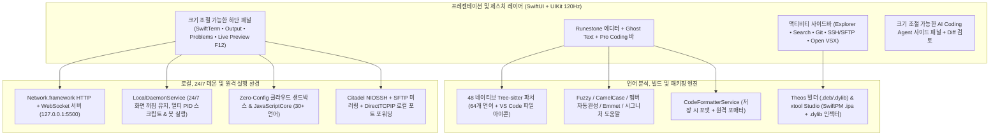

<div align="center">
  <p>
    
  </p>
  <p><strong>iOS 및 iPadOS용 네이티브 코드 에디터, 원격 개발 워크스테이션 &amp; AI 코딩 IDE</strong></p>

  <p>
    <a href="README.md">Tiếng Việt</a> |
    <a href="README.en.md">English</a> |
    <a href="README.zh-CN.md">简体中文</a> |
    <a href="README.ja.md">日本語</a> |
    <strong>한국어</strong> |
    <a href="README.ru.md">Русский</a> |
    <a href="README.es.md">Español</a>
  </p>

  <p>
    <a href="https://github.com/userlethekhoi/3012/actions/workflows/build-ipa.yml">
      
    </a>
    <a href="https://github.com/userlethekhoi/3012/releases/latest">
      
    </a>
    <a href="https://github.com/userlethekhoi/3012/releases/latest/download/3012-Unsigned.ipa">
      
    </a>
    
    
    <a href="LICENSE">
      
    </a>
  </p>
</div>

---

## 개요

**3012**(`com.dev.app3012`)는 **iOS 15.0+** 및 **iPadOS 15.0+**를 위해 `SwiftUI`와 `UIKit`으로 제작된 100% 네이티브 통합 개발 환경(IDE)입니다. WebView나 Electron 래퍼 없이 모바일 기기에서도 **VS Code**와 **Cursor** 수준의 개발 워크플로를 제공합니다.

에디터 엔진은 `Runestone`과 **48개의 정적 컴파일 C/C++ `Tree-sitter` AST 파서**를 기반으로 120Hz ProMotion 스크롤을 지원하며, 내장 `localhost:5500` Live Server, **기기 내 24/7 백그라운드 데몬 & 텔레그램 봇 실행기**, **Theos Tweak**(`.deb`/`.dylib`) 빌더, **xtool Studio**(SwiftPM `.ipa` 패키징 & Mach-O `.dylib` 인젝터), `SwiftTerm`(`xterm-256color`) 터미널, `Citadel` **SSH/SFTP** 원격 개발 및 Diff 검토 기능을 갖춘 **Coding Agent**를 포함합니다.

---

## 다운로드 및 설치

`main` 브랜치에 푸시할 때마다 GitHub Actions(`macos-15` / Xcode 16+)가 자동으로 빌드하여 **Releases**에 **`3012-Unsigned.ipa`**를 배포합니다(iOS 15/16+ **TrollStore** 및 `.p12` 사이드로딩 도구와 즉시 호환되는 Ad-hoc 서명 포함).

- **최신 버전 직접 다운로드:** [**3012-Unsigned.ipa (Latest Release)**](https://github.com/userlethekhoi/3012/releases/latest/download/3012-Unsigned.ipa)
- **전체 릴리스 및 SHA-256 체크섬:** [GitHub Releases](https://github.com/userlethekhoi/3012/releases)

### 설치 방법 (TrollStore / `.p12` / 사이드로드)

| 설치 도구 | 요구 사항 | 절차 |
| :--- | :--- | :--- |
| **TrollStore** | CoreTrust 지원 iOS 15.0+ – 17.0 | TrollStore에서 `3012-Unsigned.ipa`를 바로 열어 재서명 없이 영구 설치합니다. |
| **Feather / ESign / GBox** | 개인 `.p12` 인증서 + `.mobileprovision` | 앱에 인증서를 불러온 뒤 `3012-Unsigned.ipa`를 선택하고 **Sign & Install**을 누릅니다. |
| **AltStore / SideStore** | 개인 Apple ID (무료 또는 유료) | **My Apps (+)**에서 `3012-Unsigned.ipa`를 열어 자동 서명 및 갱신을 진행합니다. |
| **Sideloadly (macOS / Windows)** | Apple ID 또는 개발자 인증서 | `3012-Unsigned.ipa`를 끌어다 놓고 USB 또는 Wi-Fi로 설치합니다. |

---

## 시스템 아키텍처



---

## 주요 기능

### 1. 120Hz 네이티브 에디터, 64개 언어, 탭 스트립 및 크기 조절 분할 화면
- **48개의 컴파일된 C/C++ `Tree-sitter` 파서**와 3단계 언어 감지(`Dockerfile`, `Makefile`, `Package.swift`, `xtool.yml`, `Tweak.x` 등 특수 파일명 + **145개 이상 확장자** + Shebang 검사)를 제공하며, 파일 트리와 탭에 **VS Code Seti 언어 아이콘**을 표시합니다.
- 시스템(`C`, `C++`, `Rust`, `Go`, `Zig`, `Objective-C`, `Logos`), 웹(`HTML`, `CSS`, `SCSS`, `JS`, `TS`, `TSX`, `Vue`, `Svelte`, `Astro`), 모바일(`Swift`, `Dart`, `Kotlin`, `Java`), 스크립팅(`Python`, `PHP`, `Ruby`, `Lua`, `Elixir`), 설정/인프라(`SQL`, `JSON`, `YAML`, `TOML`, `Makefile`, `CMake`, `Terraform`) 등 64개 언어를 지원합니다.
- **VS Code 스타일 탭 바 & 외부 파일 연동:** 탭 고정(`Pin Tab`), 닫은 탭 다시 열기(`Cmd + Shift + T`), iOS **파일** 앱에서 단일 파일/폴더/`.zip` 열기(자동 압축 해제 및 `NSFileCoordinator` 양방향 동기화)를 지원합니다.
- **자유로운 크기 조절 분할 창:** 하단 콘솔/미리보기, 오른쪽 AI Agent 패널, Markdown + Mermaid 분할 보기를 드래그하여 크기를 조절할 수 있습니다(더블 탭으로 기본 비율 복원).
- **Pro Coding 액세서리 바:** 햅틱 피드백이 포함된 **Trackpad** 커서/선택 이동, 길게 눌러 반복되는 방향키, 괄호/연산자 입력용 **Flick Keys**, Ghost Text 수락 `Tab` 키, 원탭 Undo/Redo/Copy/Paste 및 **핀치 줌 글꼴 크기 조절**을 제공합니다.

### 2. Smart IntelliSense, 인라인 Ghost Text, 자동 포맷 & 실시간 오류 진단
- **VS Code 수준 자동완성(`CodeIntelligenceService`):** Fuzzy 매칭 및 CamelCase/`snake_case` 약어(`gEBI` -> `getElementById`, `umap` -> `std::unordered_map`), `.`/`->`/`::`/`#include <` 입력 즉시 제안, HTML/Vue/Svelte 내부 `<style>` CSS & `<script>` JS 컨텍스트 인식, **Emmet**, 인라인 **Ghost Completion**, **Theos Logos**(`%hook`, `%orig`) 및 **`xtool.yml`/`Package.swift`** 자동완성을 지원합니다.
- **코드 포매터(`CodeFormatterService`):** 저장/실행 시 자동 포맷(`Cmd + Shift + F`)과 원격 VPS 포매터(`clang-format`, `gofmt`, `rustfmt`, `black`, `prettier`) 및 오프라인 포매터(`Makefile`, `Go`의 `\t` 유지)를 제공합니다.
- **인라인 오류 진단:** 에디터 줄에 오류를 직접 강조 표시하며 **Problems** 탭 및 원탭 **Agent 수정**과 연동됩니다.

### 3. VS Code 파일 상태 색상 표시 (`U` / `A` / `M` / `D`)
| 배지 | 상태 | 색상 | 의미 |
| :---: | :--- | :--- | :--- |
| **`U`** | Untracked | 초록 (`#73C991`) | 작업 공간에 새로 만든 파일 |
| **`A`** | Added Code | 초록 (`#73C991`) | 기존 파일에 새 코드 줄/블록이 추가됨 |
| **`M`** | Modified | 황갈색 (`#E2C08D`) | 기존 줄이 제자리에서 수정됨 |
| **`D`** | Deleted | 빨강 (`#F14C4C` + 취소선) | 삭제된 파일(원래 위치에 표시되며 **원탭 복원** 가능) |

### 4. 내장 Live Server (`127.0.0.1:5500`) & 기기 내 24/7 백그라운드 데몬 / 봇 실행
- **Live Server `:5500` & 모바일 F12 DevTools:** `Network.framework` 기반 HTTP + WebSocket 서버로 `.html`/`.css`/`.js` 저장 시 자동 **Hot-Reload**를 수행하며 Safari 또는 분할 미리보기에서 콘솔 로그, JS Eval, 반응형 뷰포트(`390px` / `768px` / `1280px`)를 확인할 수 있습니다.
- **기기 내 24/7 백그라운드 유지 & 텔레그램 봇(`LocalDaemonService`):** 무음 `AVAudioSession` 루프 + `beginBackgroundTask` + `NWPathMonitor`를 통해 화면을 끄거나 앱을 전환해도 `localhost:5500`, SSH PTY 및 백그라운드 스크립트가 중단되지 않습니다. `.env` 토큰 관리를 포함한 **원탭 텔레그램 봇 생성**, `.js` 데몬(`fetch`, `setInterval`, `fs`, `process.deviceStatus()`), Python 봇 어댑터, 다중 `PID` 실시간 로그 및 오류 시 자동 재시작을 지원합니다.

### 5. 온디바이스 iOS 개발: `xtool` Studio & Theos Tweak 빌더 (`.deb` / `.dylib`)
- **xtool Studio(`XtoolBuildService`):** SwiftPM + `xtool.yml` 템플릿, `Package.swift` ⇄ `xtool.yml` 양방향 동기화, SSH VPS/GitHub Actions 빌드를 제공합니다. 또한 기기 내에서 `.ipa` 압축 해제, `.dylib` 주입, 64-bit/Fat Mach-O `LC_LOAD_DYLIB` 바이너리 패치, 번들 ID/이름 변경 및 미서명 `.ipa` 재패키징을 Mac 없이 수행합니다.
- **Theos Tweak & Mod Menu 빌더(`TheosBuildService`):** **Logos Tweak** 또는 **플로팅 Mod Menu HUD** 원탭 생성, `Makefile` `_FILES` 자동 스캔, **`rootless` / `roothide` / `rootful`** 패키징을 지원합니다(Docker 격리 빌드 서버 / 개인 SSH VPS / 오프라인 `.zip` + GitHub Actions).

### 6. Zero-Config 실행, `SwiftTerm` & 원격 SSH / SFTP (`Citadel`)
- **Zero-Config Run(`Cmd + R`):** 30개 이상의 언어를 별도 컴파일러 설정 없이 실행하며, SSH VPS 연결 시 서버 컴파일러를 우선 사용합니다.
- **`SwiftTerm`(`xterm-256color`):** 오프라인에서는 UNIX/Windows 명령을 지원하는 로컬 셸로 동작하고, VPS 연결 시 실제 **Linux SSH PTY**(`vim`, `tmux`, `htop`, `pip3`, `gcc`, `gdb`)로 자동 전환됩니다.
- **SSH, SFTP & 포트 포워딩:** **iOS Keychain**(Entitlement 없는 TrollStore 환경용 샌드박스 폴백 포함), 원탭 **Ed25519** 키 생성, SFTP 편집 및 저장 시 자동 업로드, **로컬 포트 포워딩(`localhost:<port>` ⇄ `VPS:<port>`)**을 제공합니다.

### 7. AI Coding Agent, Theme Studio, Open VSX & 7개 언어 지원
- **자유 설정 가능한 AI Coding Agent:** OpenAI, Claude, Gemini, DeepSeek, OpenRouter, xAI Grok, Groq, Mistral, Qwen, Z.ai GLM, 로컬 네트워크 **Ollama / LM Studio**, **Apple On-Device**(iOS 26+)를 지원하며 SSE 스트리밍, `/models` 자동 조회 및 **Diff Preview(`Accept & Save` / `Reject`)**를 제공합니다.
- **Theme Studio & Open VSX(`.vsix`):** 14개 이상의 내장 테마, 커스텀 구문 색상 편집기, **Open VSX** `.vsix` 테마/스니펫 직접 설치를 지원합니다.
- **7개 UI 언어:** `Tiếng Việt`, `English`, `简体中文`, `日本語`, `한국어`, `Русский`, `Español` 전환 가능.

---

## 개인정보 보호

- **데이터 수집 없음:** 분석 SDK, 광고, 중계 프록시 서버가 포함되어 있지 않습니다.
- **로컬 자격 증명 저장:** API 키, VPS 비밀번호, SSH 개인 키, GitHub 토큰은 기기 내 **iOS Keychain**(또는 샌드박스 보안 저장소)에만 저장됩니다.

---

## 하드웨어 키보드 단축키 (Magic Keyboard / Bluetooth)

| 단축키 | 기능 |
| :--- | :--- |
| `Cmd + S` | 현재 파일 저장, 자동 포맷 및 타임라인 스냅샷 생성 |
| `Cmd + Shift + F` | 현재 문서 언어별 자동 포맷 |
| `Cmd + R` | 스마트 실행 (`Live Server` / `Sandbox` / `Theos` / `xtool` / `SSH`) |
| `Cmd + P` | 명령 팔레트 및 빠른 파일 열기 |
| `Cmd + F` / `Cmd + G` | 찾기 및 바꾸기 / 다음 일치 항목 (`Ctrl + G`: 줄 이동) |
| `Cmd + /` | 줄 주석 토글 |
| `Cmd + N` / `Cmd + O` | 새 파일 만들기 / 파일 앱에서 열기 |
| `Cmd + W` / `Cmd + Shift + T` | 현재 탭 닫기 / 닫은 탭 다시 열기 |
| `Cmd + B` / `Cmd + I` / `Cmd + J` | 왼쪽 사이드바 / AI Agent 패널 / 하단 터미널 토글 |
| `Opt + ↑` / `Opt + ↓` | 현재 줄 또는 선택 블록 위/아래 이동 |
| `Tab` | `Smart IntelliSense` 또는 `Ghost Completion` 수락 |

---

## 소스에서 빌드

대상 설정 및 SPM 종속성은 **XcodeGen**용 [`project.yml`](project.yml)에서 관리됩니다.

```bash
git clone https://github.com/userlethekhoi/3012.git
cd 3012
xcodegen generate
xcodebuild -resolvePackageDependencies -project App3012.xcodeproj -scheme App3012

xcodebuild build \
  -project App3012.xcodeproj \
  -scheme App3012 \
  -configuration Release \
  -sdk iphoneos \
  -derivedDataPath build \
  IPHONEOS_DEPLOYMENT_TARGET=15.0 \
  CODE_SIGN_IDENTITY="" \
  CODE_SIGNING_REQUIRED=NO \
  CODE_SIGNING_ALLOWED=NO \
  AD_HOC_CODE_SIGNING_ALLOWED=YES

mkdir -p Payload
cp -R build/Build/Products/Release-iphoneos/3012.app Payload/
codesign --force --deep --sign - --timestamp=none Payload/3012.app
zip -qry 3012-Unsigned.ipa Payload
```

---

## 저작권 및 라이선스 (GNU AGPLv3)

**Copyright (c) 2026 Le The Khoi (GitHub: [@userlethekhoi](https://github.com/userlethekhoi) • Telegram: [@coder_009](https://t.me/coder_009)).**

**3012**의 소스 코드, 아키텍처 및 브랜드 자산은 [**GNU Affero General Public License v3.0 (AGPL-3.0)**](LICENSE)에 따라 배포됩니다. 포크, 수정, `.ipa` 재배포 또는 네트워크를 통한 서비스 제공(AGPL-3.0 제13조) 시 원저작권자 표시와 [`LICENSE`](LICENSE)를 유지하고 **전체 소스 코드를 동일한 `AGPL-3.0` 라이선스로 공개**해야 합니다.
