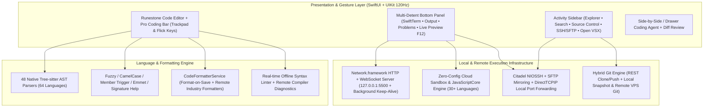

<div align="center">
  
  <h1>3012</h1>
  <p><strong>Native Code Editor, Remote Development Workstation &amp; Agentic IDE for iOS and iPadOS</strong></p>

  <p>
    <a href="https://github.com/userlethekhoi/3012/actions/workflows/build-ipa.yml">
      
    </a>
    <a href="https://github.com/userlethekhoi/3012/releases/latest">
      
    </a>
    <a href="https://github.com/userlethekhoi/3012/releases/latest/download/3012-Unsigned.ipa">
      
    </a>
    
    
  </p>
</div>

---

## Tổng quan

**3012** (`com.dev.app3012`) là môi trường phát triển tích hợp (IDE) thuần Native dành cho iOS và iPadOS, được thiết kế để mang quy trình làm việc của **VS Code** và **Cursor** lên thiết bị di động mà không đánh đổi hiệu năng thông qua lớp bọc WebView/Electron.

Toàn bộ vùng soạn thảo được xây dựng trực tiếp trên `UIKit` (`Runestone`) kết hợp **48 bộ phân tích cú pháp C/C++ `Tree-sitter` biên dịch tĩnh**, đảm bảo tốc độ cuộn 120Hz ProMotion, độ trễ nhập liệu bằng không, đồng thời tích hợp sẵn máy chủ Web cục bộ (`localhost:5500`), thiết bị đầu cuối `SwiftTerm` VT100/Xterm-256color, kết nối `SSH/SFTP` bảo mật bằng iOS Keychain và trợ lý lập trình tự hành có kiểm duyệt bản vá (`Diff Review`).

---

## Tải xuống & Cài đặt

Mỗi bản cập nhật trên nhánh `main` được hệ thống GitHub Actions biên dịch tự động trên `macos-15` (Xcode 16+) và xuất bản trực tiếp dưới dạng gói ứng dụng chưa ký (**Unsigned `.ipa`**) tại mục **Releases**.

- **Tải trực tiếp bản mới nhất:** [**3012-Unsigned.ipa (Latest Release)**](https://github.com/userlethekhoi/3012/releases/latest/download/3012-Unsigned.ipa)
- **Danh sách toàn bộ các bản phát hành & mã băm SHA-256:** [GitHub Releases](https://github.com/userlethekhoi/3012/releases)

### Hướng dẫn ký chứng chỉ (`.p12` / Sideload)

Vì gói phát hành ở định dạng chuẩn `Unsigned .ipa`, bạn có thể ký bằng chứng chỉ Apple Developer cá nhân (`.p12` + `.mobileprovision`) hoặc công cụ cài đặt tương ứng:

| Công cụ cài đặt | Yêu cầu | Quy trình thực hiện |
| :--- | :--- | :--- |
| **Feather / ESign / GBox** | Chứng chỉ `.p12` + `.mobileprovision` | Nhập chứng chỉ vào ứng dụng ký trên thiết bị, chọn file `3012-Unsigned.ipa`, bấm **Sign & Install**. |
| **AltStore / SideStore** | Apple ID cá nhân (Miễn phí hoặc Trả phí) | Mở file `3012-Unsigned.ipa` qua mục **My Apps (+)** để tự động ký và gia hạn định kỳ. |
| **Sideloadly (macOS / Windows)** | Apple ID hoặc chứng chỉ Developer | Kéo thả `3012-Unsigned.ipa` vào Sideloadly và cài đặt qua cáp USB hoặc Wi-Fi. |
| **TrollStore** | Thiết bị hỗ trợ CoreTrust | Mở trực tiếp `3012-Unsigned.ipa` trong TrollStore để cài đặt vĩnh viễn không cần ký lại. |

---

## Kiến trúc Hệ thống



---

## Tính năng Cốt lõi

### 1. Lõi Soạn thảo 120Hz & Nhận diện Toàn diện 64 Ngôn ngữ
- **48 bộ ngữ pháp `Tree-sitter` C/C++ biên dịch gốc** đi kèm cơ chế nhận diện 3 tầng: đối sánh tên tệp cấu hình đặc biệt (`Dockerfile`, `Makefile`, `CMakeLists.txt`, `Cargo.toml`), hơn **145 phần mở rộng tệp**, và phân tích dòng khai báo đầu tệp (`shebang` / chữ ký cú pháp) cho tệp không có đuôi mở rộng.
- Hỗ trợ đầy đủ các họ ngôn ngữ:
  - **Systems & Native:** C, C++, Objective-C, Rust, Go, Zig, D, Nim, Crystal, Assembly.
  - **Web & Frontend:** HTML, CSS, SCSS, JavaScript, TypeScript, TSX/JSX, Vue, Svelte, Astro, GraphQL.
  - **Mobile, JVM & .NET:** Swift, Dart, Java, Kotlin, Scala, Groovy, C#.
  - **Scripting, Data & Functional:** Python, PHP, Ruby, Perl, Lua, R, Julia, Elixir, Erlang, Haskell, OCaml, Elm, Lisp, Pascal, Solidity.
  - **Database, Config & Infrastructure:** SQL, JSON, JSON5, YAML, TOML, XML, Protocol Buffers, INI/Env, Bash/Zsh, Fish, PowerShell, Dockerfile, Makefile, CMake, Terraform/HCL, Bicep, Nix, Markdown, LaTeX, Regex, Diff.
- **Pro Coding Accessory Bar:** Tích hợp chế độ giữ-vuốt **Trackpad** di chuyển con trỏ chính xác từng ký tự kèm phản hồi xúc giác (Haptics), thao tác vuốt lên (**Flick Keys**) để nhập nhanh cặp ngoặc/toán tử, và cử chỉ thu phóng cỡ chữ (**Pinch-to-Zoom**).

### 2. Smart IntelliSense, Tự động Format theo Ngôn ngữ & Báo lỗi Trực tiếp
- **VS Code-Grade IntelliSense (`CodeIntelligenceService`):**
  - Chấm điểm **Fuzzy Subsequence** và viết tắt **CamelCase / `snake_case`** (ví dụ: gõ `gEBI` khớp `getElementById`, gõ `umap` khớp `std::unordered_map`).
  - Kích hoạt gợi ý tức thì (0 ký tự) ngay sau toán tử truy cập thành phần `.`, `->`, `::` và chỉ thị `#include <`.
  - Bộ mở rộng **Emmet** nội bộ cho HTML/JSX/Vue/Svelte (`!`, `div.card`, `button#submit`, `ul>li*3`), đặt con trỏ tự động vào đúng vị trí thao tác (`$0`), lập chỉ mục hàm xuyên toàn bộ dự án và hiển thị khung nhắc chữ ký tham số hàm (**Signature Help**) ngay khi mở ngoặc.
  - Tự động thụt lề khối lệnh thông minh khi nhấn `Return` giữa `{|}`, `(|)`, `[|]` hoặc sau dấu `:`.
- **Tự động Format Code (`CodeFormatterService`):**
  - Hỗ trợ **Format-on-Save / Format-on-Run** và tổ hợp phím `Cmd + Shift + F`.
  - Kết hợp trình định dạng công nghiệp trên VPS qua SSH (`clang-format`, `gofmt`, `rustfmt`, `zig fmt`, `black`, `prettier`, `dart format`, `swift-format`, `shfmt`, `terraform fmt`, `nixfmt`) với bộ định dạng nội bộ ngoại tuyến bảo toàn chuỗi/chú thích cho cả 64 ngôn ngữ (bao gồm bảo toàn ký tự `\t` bắt buộc cho `Makefile` và `Go`).
- **Chẩn đoán Lỗi Trực tiếp (`Inline Diagnostics`):** Tô sáng trực tiếp dòng lỗi/cảnh báo ngay trên trình soạn thảo kết hợp bảng **Problems** cho phép nhảy tới dòng lỗi hoặc chuyển ngữ cảnh sang Coding Agent để đề xuất bản vá.

### 3. Hệ thống Màu sắc Trạng thái File Chuẩn VS Code (`Working-Tree Decorations`)
Cây thư mục **Explorer**, thanh **Tab đang mở**, và bảng **Source Control** đồng bộ trạng thái thay đổi theo thời gian thực dựa trên mốc cơ sở của dự án:

| Nhãn | Trạng thái | Màu hiển thị | Ý nghĩa kỹ thuật |
| :---: | :--- | :--- | :--- |
| **`U`** | Untracked | Xanh lá (`#73C991`) | Tệp mới được khởi tạo trong không gian làm việc. |
| **`A`** | Added Code | Xanh lá (`#73C991`) | Tệp hiện có được bổ sung thêm dòng lệnh hoặc khối mã nguồn mới. |
| **`M`** | Modified | Vàng hổ phách (`#E2C08D`) | Tệp được chỉnh sửa tại chỗ (thay đổi giá trị/logic) không bổ sung thêm dòng mới. |
| **`D`** | Deleted | Đỏ (`#F14C4C` + gạch ngang) | Tệp vừa bị xóa — vẫn hiển thị trực quan tại vị trí gốc kèm nút **Khôi phục 1 chạm**. |

Các thư mục cha tự động tổng hợp trạng thái của tệp bên trong và hiển thị chấm màu chỉ báo ở cạnh phải tương tự VS Code.

### 4. Built-in Live Server (`127.0.0.1:5500`) & Mobile Web DevTools
- Máy chủ HTTP + WebSocket viết trực tiếp bằng `Network.framework` (`NWListener`), tự động tiêm kênh tín hiệu **Hot-Reload** để làm mới trang tức thì mỗi khi lưu tệp `.html`, `.css`, `.js`.
- **Background Keep-Alive:** Duy trì tiến trình máy chủ `localhost:5500` và đường hầm cổng SSH không bị hệ điều hành iOS đóng băng khi chuyển sang kiểm thử giao diện trên **Safari** hoặc **Chrome**.
- **In-App Web DevTools (`F12`):** Thu thập trực tiếp luồng `console.log`, `console.warn`, `console.error`, ngoại lệ `window.onerror`, cho phép thực thi biểu thức JavaScript trực tiếp và chuyển đổi khung nhìn chuẩn thiết bị (`390px`, `768px`, `1280px`).

### 5. Thực thi Zero-Config & Phát triển Từ xa qua SSH / SFTP (`Citadel` + `SwiftTerm`)
- **Zero-Config 1-Tap Run:** Thực thi trực tiếp hơn **30 ngôn ngữ biên dịch và thông dịch** (C, C++20, Rust, Go, Java, C#, Python, Swift, Zig, PHP, Ruby, Lua, SQL, Haskell, Elixir...) ngay trên điện thoại không cần cấu hình trình biên dịch thủ công.
- **Remote SSH & SFTP Workstation:**
  - Quản lý hồ sơ máy chủ Linux, lưu trữ mật khẩu/khóa bảo mật trong **iOS Keychain**, hỗ trợ sinh cặp khóa **Ed25519** một chạm.
  - Duyệt cây thư mục SFTP từ xa, chỉnh sửa tệp ở tốc độ 120Hz cục bộ và tự động đồng bộ ngược lên VPS khi lưu.
  - Thiết bị đầu cuối tương tác **`SwiftTerm` (`xterm-256color`)** hỗ trợ đầy đủ `vim`, `tmux`, `htop`, `git`, `gdb` và **SSH Local Port Forwarding (`localhost:<port>` ⇄ `VPS:<port>`)**.

### 6. Agentic Coding Assistant & Hệ sinh thái Theme / Open VSX
- **Coding Agent tích hợp cạnh vùng soạn thảo:** Tương thích với Google Gemini, OpenAI, Anthropic Claude, DeepSeek, OpenRouter và endpoint tự triển khai. Agent đọc ngữ cảnh toàn dự án, phân tích đầu ra lỗi biên dịch và đề xuất thay đổi qua giao diện kiểm duyệt **Diff Preview (`Accept & Save` / `Reject`)**.
- **Theme Studio & Open VSX (`.vsix`):** Đi kèm 14 bảng màu chuẩn (*Tokyo Night*, *Cursor Midnight*, *One Dark Pro*, *Dracula*, *Catppuccin*, *Xcode*, *GitHub*...), công cụ **Theme Studio** tùy biến từng mã màu cú pháp, và trình tải trực tiếp gói `.vsix` từ chợ **Open VSX** để cài đặt Color Themes & Snippets.

---

## Phím tắt Bàn phím Cứng (Magic Keyboard / Bluetooth)

| Tổ hợp phím | Chức năng |
| :--- | :--- |
| `Cmd + S` | Lưu tệp hiện tại, tự động Format (nếu bật) và ghi mốc lịch sử phiên bản |
| `Cmd + Shift + F` | Định dạng mã nguồn (Format Document) theo ngôn ngữ của tệp đang mở |
| `Cmd + R` | Thực thi thông minh tệp hiện tại (Live Server / Zero-Config Sandbox / SSH VPS) |
| `Cmd + P` | Mở bảng điều khiển lệnh & tìm mở nhanh tệp (`Command Palette & Quick Open`) |
| `Cmd + /` | Bật hoặc tắt chú thích dòng (`Toggle Line Comment`) theo ngôn ngữ |
| `Cmd + B` | Đóng hoặc mở thanh công cụ bên trái (`Activity Sidebar`) |
| `Cmd + I` | Đóng hoặc mở khung trợ lý lập trình (`Coding Agent Panel`) |
| `Cmd + J` | Đóng hoặc mở ngăn kéo dưới (`Terminal / Output / Problems / Live Preview`) |
| `Tab` | Chấp nhận đề xuất đầu tiên trong thanh gợi ý `Smart IntelliSense` |

---

## Tự Biên dịch từ Mã nguồn (Build from Source)

Dự án quản lý cấu hình biên dịch và phụ thuộc Swift Package Manager hoàn toàn thông qua đặc tả khai báo [`project.yml`](project.yml) (**XcodeGen**) nhằm đảm bảo tính tái lập tuyệt đối và tránh xung đột tệp `.xcodeproj`.

### Yêu cầu môi trường
- macOS 15.0+ đi kèm **Xcode 16.0+**
- [**XcodeGen**](https://github.com/yonaskolb/XcodeGen) (`brew install xcodegen`)

### Các bước biên dịch gói `3012-Unsigned.ipa`

```bash
# 1. Sao chép mã nguồn
git clone https://github.com/userlethekhoi/3012.git
cd 3012

# 2. Sinh tệp dự án Xcode từ project.yml
xcodegen generate

# 3. Tải các gói phụ thuộc Swift Package Manager
xcodebuild -resolvePackageDependencies -project App3012.xcodeproj -scheme App3012

# 4. Biên dịch bản Release cho thiết bị iOS (arm64, không yêu cầu chứng chỉ ký sẵn)
xcodebuild build \
  -project App3012.xcodeproj \
  -scheme App3012 \
  -configuration Release \
  -sdk iphoneos \
  -derivedDataPath build \
  CODE_SIGN_IDENTITY="" \
  CODE_SIGNING_REQUIRED=NO \
  CODE_SIGNING_ALLOWED=NO \
  AD_HOC_CODE_SIGNING_ALLOWED=YES

# 5. Đóng gói thành 3012-Unsigned.ipa
mkdir -p Payload
cp -R build/Build/Products/Release-iphoneos/3012.app Payload/
zip -qry 3012-Unsigned.ipa Payload
```

---

## Cấu trúc Thư mục Dự án

```text
3012/
├── .github/workflows/
│   └── build-ipa.yml               # Pipeline CI/CD biên dịch & phát hành tự động lên GitHub Releases
├── Config/
│   └── Info.plist                  # Khai báo quyền hệ thống, mạng cục bộ và chế độ chạy nền
├── Resources/
│   └── Assets.xcassets/            # Biểu tượng ứng dụng vector SVG gốc (AppIcon)
├── Sources/
│   ├── App/
│   │   └── App3012Main.swift       # Điểm khởi chạy ứng dụng & bố cục điều phối trung tâm
│   ├── Models/
│   │   ├── AIAgentModels.swift     # Cấu trúc tin nhắn, cấu hình nhà cung cấp AI & bản vá Diff
│   │   ├── EditorThemeModel.swift  # Hệ thống bảng màu cú pháp, trình nhập Theme VS Code & tùy chọn
│   │   └── WorkspaceModels.swift   # Định nghĩa 64 ngôn ngữ, ánh xạ Tree-sitter & trạng thái Diff U/A/M/D
│   ├── Services/
│   │   ├── AIAgentService.swift            # Luồng gọi API LLM đa nhà cung cấp & trích xuất chỉnh sửa tệp
│   │   ├── CodeFormatterService.swift      # Bộ định dạng mã nguồn theo ngôn ngữ (Offline + SSH VPS)
│   │   ├── CodeIntelligenceService.swift   # Smart IntelliSense, Fuzzy/CamelCase, Emmet & Inline Diagnostics
│   │   ├── CodeRunnerService.swift         # Bộ định tuyến thực thi Zero-Config cho hơn 30 ngôn ngữ
│   │   ├── ExtensionStoreService.swift     # Tích hợp Open VSX API & giải nén gói .vsix (ZIPFoundation)
│   │   ├── FileTimelineAndArchiveService.swift # Lưu trữ 20 mốc lịch sử tệp cục bộ & nhập/xuất dự án .zip
│   │   ├── GitService.swift                # Quản lý phiên bản cục bộ, GitHub REST Clone/Push & Remote Git
│   │   ├── KeychainVault.swift             # Lưu trữ bảo mật thông tin xác thực & sinh khóa SSH Ed25519
│   │   ├── LiveServerService.swift         # Máy chủ HTTP + WebSocket (:5500) & chế độ Background Keep-Alive
│   │   ├── LocalShellEngine.swift          # Trình giả lập lệnh UNIX thao tác tệp trực tiếp khi ngoại tuyến
│   │   ├── SSHWorkspaceService.swift       # Kết nối Citadel SSH/SFTP, cài đặt Toolchain & Port Forwarding
│   │   └── WorkspaceManager.swift          # Quản lý cây tệp, đa tab, tìm kiếm toàn cục & theo dõi Diff cơ sở
│   └── Views/
│       ├── AI/AIAgentSidePanel.swift           # Giao diện hội thoại Agent & bảng duyệt thay đổi mã nguồn
│       ├── Components/IDEVectorIcons.swift     # Hệ thống biểu tượng vector thuần khiết & SF Symbols
│       ├── Editor/
│       │   ├── ProCodingAccessoryBar.swift     # Thanh phím tắt lập trình, Trackpad con trỏ & Flick Keys
│       │   └── RunestoneEditorView.swift       # Cầu nối UIKit TextView 120Hz, Auto-Indent & HighlightedRange
│       ├── Panels/
│       │   ├── BottomConsolePreviewPanel.swift # Khung Terminal, Output, Problems & Live Preview DevTools
│       │   ├── CommandPaletteSheet.swift       # Bảng điều khiển lệnh nhanh & mở tệp tức thì
│       │   ├── MarkdownMermaidPreviewView.swift# Trình kết xuất tài liệu Markdown & sơ đồ Mermaid trực tiếp
│       │   ├── SwiftTermTerminalView.swift     # Tích hợp thiết bị đầu cuối Xterm-256color & SSH PTY
│       │   └── SymbolAndTimelineSheets.swift   # Danh sách hàm, lịch sử tệp, Theme Studio & chọn ngôn ngữ
│       ├── Settings/SettingsAndThemesSheet.swift # Giao diện tùy chỉnh trình soạn thảo, phông chữ & phím tắt
│       └── Sidebar/LeftExplorerDrawer.swift    # Ngăn kéo 5 phân hệ chuẩn VS Code kèm hiển thị màu U/A/M/D
└── project.yml                     # Đặc tả cấu hình dự án XcodeGen & danh sách phụ thuộc SPM
```

---

## Giấy phép

Mã nguồn dự án được phát triển và lưu trữ tại [github.com/userlethekhoi/3012](https://github.com/userlethekhoi/3012).
