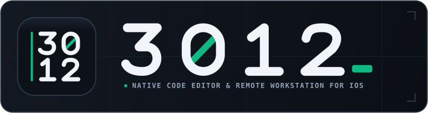
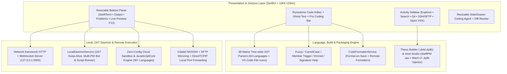

<div align="center">
  <p>
    
  </p>
  <p><strong>Native Code Editor, Remote Development Workstation &amp; Agentic IDE for iOS and iPadOS</strong></p>

  <p>
    <strong>Tiếng Việt</strong> |
    <a href="README.en.md">English</a> |
    <a href="README.zh-CN.md">简体中文</a> |
    <a href="README.ja.md">日本語</a> |
    <a href="README.ko.md">한국어</a> |
    <a href="README.ru.md">Русский</a> |
    <a href="README.es.md">Español</a>
  </p>

  <p>
    <a href="https://github.com/userlethekhoi/3012/actions/workflows/build-ipa.yml">
      
    </a>
    <a href="https://github.com/userlethekhoi/3012/releases/latest">
      
    </a>
    <a href="https://github.com/userlethekhoi/3012/releases/latest/download/3012-Unsigned.ipa">
      
    </a>
    
    
    <a href="LICENSE">
      
    </a>
  </p>
</div>

---

## Tổng quan

**3012** (`com.dev.app3012`) là môi trường phát triển tích hợp (IDE) thuần Native dành cho **iOS 15.0+** và **iPadOS 15.0+**, được thiết kế để mang quy trình làm việc của **VS Code** và **Cursor** lên thiết bị di động mà không đánh đổi hiệu năng qua lớp bọc WebView/Electron.

Vùng soạn thảo được xây dựng trực tiếp trên `UIKit` (`Runestone`) kết hợp **48 bộ phân tích cú pháp C/C++ `Tree-sitter` biên dịch tĩnh**, đảm bảo cuộn mượt 120Hz ProMotion, tích hợp sẵn máy chủ Web `localhost:5500`, hệ thống chạy ngầm **24/7 On-Device Daemon & Telegram Bot**, trình tạo/biên dịch **Theos Tweak** (`.deb`/`.dylib`) và **xtool Studio** (build `.ipa` từ SwiftPM & nhúng `.dylib`), thiết bị đầu cuối **`SwiftTerm`** (`xterm-256color`), kết nối **`SSH/SFTP`** (`Citadel`) và **Coding Agent** hỗ trợ duyệt Diff.

---

## Tải xuống & Cài đặt

Mỗi bản cập nhật trên nhánh `main` được hệ thống GitHub Actions biên dịch tự động trên `macos-15` (Xcode 16+) và xuất bản dưới dạng gói **`3012-Unsigned.ipa`** tại mục **Releases** (đã kèm chữ ký ad-hoc tương thích trực tiếp với **TrollStore trên iOS 15/16+** và các công cụ ký chứng chỉ `.p12`).

- **Tải trực tiếp bản mới nhất:** [**3012-Unsigned.ipa (Latest Release)**](https://github.com/userlethekhoi/3012/releases/latest/download/3012-Unsigned.ipa)
- **Danh sách toàn bộ các bản phát hành & mã băm SHA-256:** [GitHub Releases](https://github.com/userlethekhoi/3012/releases)

### Hướng dẫn cài đặt (`.p12` / TrollStore / Sideload)

| Công cụ cài đặt | Yêu cầu | Quy trình thực hiện |
| :--- | :--- | :--- |
| **TrollStore** | iOS 15.0+ – 17.0 hỗ trợ CoreTrust | Mở trực tiếp `3012-Unsigned.ipa` bằng TrollStore để cài đặt vĩnh viễn, không cần gia hạn chứng chỉ. |
| **Feather / ESign / GBox** | Chứng chỉ `.p12` + `.mobileprovision` | Nhập chứng chỉ vào ứng dụng ký trên thiết bị, chọn `3012-Unsigned.ipa`, bấm **Sign & Install**. |
| **AltStore / SideStore** | Apple ID cá nhân (Miễn phí hoặc Trả phí) | Mở `3012-Unsigned.ipa` qua mục **My Apps (+)** để tự động ký và gia hạn định kỳ. |
| **Sideloadly (macOS / Windows)** | Apple ID hoặc chứng chỉ Developer | Kéo thả `3012-Unsigned.ipa` vào Sideloadly và cài đặt qua USB hoặc Wi-Fi. |

---

## Kiến trúc Hệ thống



---

## Tính năng Cốt lõi

### 1. Lõi Soạn thảo 120Hz, 64 Ngôn ngữ & Thanh Tab / Split View Chuẩn Desktop
- **48 bộ ngữ pháp `Tree-sitter` C/C++ biên dịch gốc** nhận diện 3 tầng (tên tệp cấu hình đặc biệt như `Dockerfile`, `Makefile`, `Package.swift`, `xtool.yml`, `Tweak.x`, hơn **145 phần mở rộng**, và kiểm tra `shebang` nội dung tệp), hiển thị **icon ngôn ngữ chuẩn VS Code Seti** trên cây thư mục và thanh tab.
- Hỗ trợ 64 ngôn ngữ từ Systems (`C`, `C++`, `Rust`, `Go`, `Zig`, `Objective-C`, `Logos`), Web (`HTML`, `CSS`, `SCSS`, `JS`, `TS`, `TSX`, `Vue`, `Svelte`, `Astro`), Mobile (`Swift`, `Dart`, `Kotlin`, `Java`), Scripting (`Python`, `PHP`, `Ruby`, `Lua`, `Elixir`) đến Config/Infra (`SQL`, `JSON`, `YAML`, `TOML`, `Makefile`, `CMake`, `Terraform`).
- **Hàng Tab VS Code riêng biệt:** Mở mới đặt bên trái, hỗ trợ ghim tab (`Pin Tab`), mở lại tab vừa đóng (`Cmd + Shift + T`), mở trực tiếp **tệp lẻ bên ngoài hoặc thư mục / file `.zip`** qua ứng dụng Files (tự giải nén dự án và đồng bộ 2 chiều qua `NSFileCoordinator`).
- **Khung Split View kéo giãn tự do:** Thanh chia có thể kéo điều chỉnh kích thước linh hoạt (nhấn đúp để đặt lại) cho bảng Console/Live Preview dưới đáy, khung Coding Agent bên phải và Markdown + Mermaid Split Preview.
- **Pro Coding Accessory Bar:** Bàn phím phụ 2 hàng tích hợp **Trackpad** di chuyển con trỏ/bôi đen kèm Haptics, phím mũi tên giữ để lặp, **Flick Keys** nhập nhanh cặp ngoặc/toán tử, phím **Tab** nhận Ghost Text, Undo/Redo/Copy/Paste 1 chạm và cử chỉ **Pinch-to-Zoom**.

### 2. Smart IntelliSense, Inline Ghost Text, Auto-Format & Báo lỗi Trực tiếp
- **VS Code-Grade IntelliSense (`CodeIntelligenceService`):**
  - Chấm điểm **Fuzzy Subsequence** và viết tắt **CamelCase / `snake_case`** (`gEBI` -> `getElementById`, `umap` -> `std::unordered_map`).
  - Kích hoạt gợi ý tức thì sau `.`, `->`, `::`, `#include <`, hỗ trợ viết code HTML/CSS/JS trong cùng tệp `.html`/`.vue`/`.svelte`, mở rộng **Emmet** (`!`, `div.card`, `ul>li*3`) và hiển thị **Ghost Completion mờ** ngay tại con trỏ (chạm chữ mờ hoặc bấm `Tab` để chèn).
  - Gợi ý từ khóa **Theos Logos** (`%hook`, `%orig`, `%ctor`, `MSHookFunction`), **`xtool.yml`** và **`Package.swift`**, kèm **Symbol Outline**, Breadcrumbs và **Find & Replace** nội tuyến (`Cmd + F`).
- **Tự động Format Code (`CodeFormatterService`):** Hỗ trợ **Format-on-Save / Format-on-Run** và `Cmd + Shift + F`, kết hợp trình định dạng công nghiệp trên VPS (`clang-format`, `gofmt`, `rustfmt`, `black`, `prettier`, `swift-format`...) với bộ format nội tuyến bảo toàn `\t` cho `Makefile` và `Go`.
- **Inline Diagnostics:** Tô màu trực tiếp dòng lỗi ngay trên Editor kèm tab **Problems** và nút chuyển sang Coding Agent.

### 3. Hệ thống Màu sắc Trạng thái File Chuẩn VS Code (`U` / `A` / `M` / `D`)
| Nhãn | Trạng thái | Màu hiển thị | Ý nghĩa |
| :---: | :--- | :--- | :--- |
| **`U`** | Untracked | Xanh lá (`#73C991`) | Tệp mới tạo trong workspace. |
| **`A`** | Added Code | Xanh lá (`#73C991`) | Tệp hiện có được bổ sung thêm dòng/khối code mới. |
| **`M`** | Modified | Vàng hổ phách (`#E2C08D`) | Tệp sửa đổi nội dung tại chỗ. |
| **`D`** | Deleted | Đỏ (`#F14C4C` + gạch ngang) | Tệp đã xóa — vẫn hiện tại vị trí gốc kèm nút **Khôi phục 1 chạm**. |

### 4. Built-in Live Server (`127.0.0.1:5500`) & Treo Bot / Script Ngầm 24/7 Trên Máy
- **Live Server `:5500` & Mobile Web DevTools (`F12`):** Máy chủ HTTP + WebSocket viết trực tiếp bằng `Network.framework`, tự tiêm Hot-Reload khi lưu `.html`/`.css`/`.js`, xem ngay trên **Safari** hoặc khung **Split Preview** kèm bắt `console.log`/`error` và đổi khung nhìn (`390px`, `768px`, `1280px`).
- **Treo Bot Telegram & Tiến trình Ngầm 24/7 Trên Thiết bị (`LocalDaemonService`):**
  - Giữ ứng dụng, cổng `localhost:5500`, kết nối SSH PTY và các script đang chạy **không bị iOS đóng băng khi khóa màn hình hoặc thoát ra Home** (`AVAudioSession` Silent Loop + `beginBackgroundTask` + `NWPathMonitor`).
  - Khởi tạo nhanh **Bot Telegram 1 chạm** kèm quản lý token trong `.env`, chạy trực tiếp file `.js` (`fetch`, `setInterval`, `fs`, `process.deviceStatus()` đọc % pin/mạng) hoặc chuyển đổi script Bot `.py`, quản lý đa tiến trình theo `PID`, tự khởi động lại khi lỗi mạng và xem log theo thời gian thực.

### 5. Phát triển iOS Trên Máy: `xtool` Studio & Build Theos Tweak (`.deb` / `.dylib`)
- **xtool Studio (`XtoolBuildService`):**
  - Tạo nhanh dự án SwiftPM chuẩn `xtool.yml` (`SwiftUI App`, `SwiftUI App + Widget`, `Host App + .dylib`), đồng bộ hai chiều `Package.swift` ⇄ `xtool.yml`, tự nhận diện SDK iOS hoặc build qua SSH VPS / GitHub Actions.
  - **On-Device Mach-O `.dylib` Injector:** Giải nén bất kỳ file `.ipa` nào ngay trên iPhone/iPad, nhúng `.dylib` vào `Payload/<App>.app/Frameworks/`, vá trực tiếp header Mach-O 64-bit / Fat Binary (`LC_LOAD_DYLIB`), tùy chỉnh `CFBundleIdentifier` / `CFBundleDisplayName` và xuất ra `.ipa` mới không cần máy Mac.
- **Theos Tweak & Mod Menu Builder (`TheosBuildService`):**
  - Khởi tạo 1 chạm **Logos Tweak** hoặc **Floating Mod Menu HUD**, trợ lý quét tự động danh sách file nguồn điền vào `Makefile` (`_FILES`), hỗ trợ gói **`rootless` / `roothide` / `rootful`**.
  - Biên dịch ra `.deb` và `.dylib` qua 3 chế độ: Build Server cách ly Docker, SSH VPS cá nhân, hoặc đóng gói `.zip` kèm GitHub Actions workflow.

### 6. Thực thi Zero-Config, `SwiftTerm` & Remote SSH / SFTP (`Citadel`)
- **Zero-Config 1-Tap Run (`Cmd + R`):** Chạy hơn **30 ngôn ngữ** (C, C++20, Rust, Go, Java, C#, Python, Swift, Zig, PHP, Ruby, Lua, SQL, Haskell...) trực tiếp trên máy hoặc ưu tiên trình biên dịch thật trên VPS nếu đang nối SSH.
- **Thiết bị đầu cuối `SwiftTerm` (`xterm-256color`):**
  - Khi offline: Shell nội bộ hỗ trợ lệnh UNIX & Windows (`ls`/`dir`, `cd`, `cat`, `grep`, `tree`, `git`, `zip`/`unzip`, `curl`, `bg`, `ps`, `logs`, `keepalive`, `xtool`, `claude`, `opencode`).
  - Khi nối VPS: Tự động chuyển thành **Interactive Linux SSH PTY** (`vim`, `tmux`, `htop`, `pip3`, `gcc`, `gdb`).
- **SSH, SFTP & Port Forwarding:** Lưu mật khẩu/khóa trong **iOS Keychain** (có bộ nhớ dự phòng an toàn cho môi trường TrollStore), sinh khóa **Ed25519** 1 chạm, duyệt/sửa file SFTP trực tiếp, cài đặt nhanh toolchain VPS và **Port Forwarding (`localhost:<port>` ⇄ `VPS:<port>`)**.

### 7. Agentic Coding Assistant, Theme Studio, Open VSX & 7 Ngôn ngữ
- **AI Coding Agent linh hoạt:** Kết nối trực tiếp qua API Key cá nhân tới OpenAI, Anthropic Claude, Google Gemini, DeepSeek, OpenRouter, xAI Grok, Groq, Mistral, Qwen, Z.ai GLM, Ollama / LM Studio (mạng LAN) hoặc **Apple On-Device** (iOS 26+), hỗ trợ streaming SSE, tự cập nhật danh sách model qua `/models` và áp dụng thay đổi qua bảng **Diff Review (`Accept & Save` / `Reject`)**.
- **Theme Studio & Open VSX (`.vsix`):** Tích hợp sẵn 14+ bảng màu sáng/tối, trình tự phối màu cú pháp, và cài đặt thêm Color Themes / Snippets trực tiếp từ **Open VSX**.
- **Giao diện Đa ngôn ngữ:** Hỗ trợ chuyển đổi tức thì 7 ngôn ngữ bên trong ứng dụng (`Tiếng Việt`, `English`, `简体中文`, `日本語`, `한국어`, `Русский`, `Español`).

---

## Quyền riêng tư

- **Không thu thập dữ liệu:** 3012 không chứa công cụ theo dõi, phân tích hay quảng cáo và không gửi mã nguồn về máy chủ trung gian ngoài lựa chọn của người dùng.
- **Lưu trữ thông tin xác thực:** API Key, mật khẩu VPS, khóa SSH và GitHub Token được lưu cục bộ trong **iOS Keychain** (hoặc vùng lưu trữ riêng trong sandbox khi cài qua TrollStore thiếu entitlement).
- **Dữ liệu AI & Build Server:** Khi dùng Coding Agent online hoặc Build Server Theos cộng đồng, dữ liệu được truyền trực tiếp tới nhà cung cấp / máy chủ bạn chọn (có hộp thoại xác nhận rõ ràng trước lần gửi đầu tiên).

---

## Phím tắt Bàn phím Cứng (Magic Keyboard / Bluetooth)

| Tổ hợp phím | Chức năng |
| :--- | :--- |
| `Cmd + S` | Lưu tệp hiện tại, tự động Format (nếu bật) và ghi mốc lịch sử phiên bản |
| `Cmd + Shift + F` | Định dạng mã nguồn (`Format Document`) theo ngôn ngữ tệp đang mở |
| `Cmd + R` | Chạy thông minh tệp/dự án hiện tại (`Live Server` / `Sandbox` / `Theos` / `xtool` / `SSH`) |
| `Cmd + P` | Mở bảng điều khiển lệnh & tìm mở nhanh tệp (`Command Palette`) |
| `Cmd + F` / `Cmd + G` | Mở thanh Tìm kiếm & Thay thế / Đi tới kết quả kế tiếp (`Ctrl + G`: Đi tới dòng) |
| `Cmd + /` | Bật hoặc tắt chú thích dòng theo ngôn ngữ |
| `Cmd + N` / `Cmd + O` | Tạo tệp mới nhanh / Mở tệp từ ứng dụng Files |
| `Cmd + W` / `Cmd + Shift + T` | Đóng tab đang mở / Mở lại tab vừa đóng |
| `Cmd + B` / `Cmd + I` / `Cmd + J` | Đóng/mở Sidebar trái / Coding Agent phải / Khay Terminal dưới |
| `Opt + ↑` / `Opt + ↓` | Đẩy dòng hoặc khối code đang chọn lên trên / xuống dưới |
| `Tab` | Chấp nhận đề xuất `Smart IntelliSense` hoặc `Ghost Completion` |

---

## Tự Biên dịch từ Mã nguồn (Build from Source)

Cấu hình target và phụ thuộc Swift Package Manager được quản lý khai báo qua [`project.yml`](project.yml) (**XcodeGen**).

### Yêu cầu môi trường
- macOS 15.0+ đi kèm **Xcode 16.0+**
- [**XcodeGen**](https://github.com/yonaskolb/XcodeGen) (`brew install xcodegen`)

### Các bước biên dịch `3012-Unsigned.ipa`

```bash
# 1. Sao chép mã nguồn
git clone https://github.com/userlethekhoi/3012.git
cd 3012

# 2. Sinh tệp dự án Xcode từ project.yml
xcodegen generate

# 3. Tải các gói phụ thuộc Swift Package Manager
xcodebuild -resolvePackageDependencies -project App3012.xcodeproj -scheme App3012

# 4. Biên dịch bản Release cho iOS 15.0+ (arm64)
xcodebuild build \
  -project App3012.xcodeproj \
  -scheme App3012 \
  -configuration Release \
  -sdk iphoneos \
  -derivedDataPath build \
  IPHONEOS_DEPLOYMENT_TARGET=15.0 \
  CODE_SIGN_IDENTITY="" \
  CODE_SIGNING_REQUIRED=NO \
  CODE_SIGNING_ALLOWED=NO \
  AD_HOC_CODE_SIGNING_ALLOWED=YES

# 5. Ký ad-hoc (tương thích TrollStore) & đóng gói thành 3012-Unsigned.ipa
mkdir -p Payload
cp -R build/Build/Products/Release-iphoneos/3012.app Payload/
codesign --force --deep --sign - --timestamp=none Payload/3012.app
zip -qry 3012-Unsigned.ipa Payload
```

---

## Cấu trúc Thư mục Dự án

```text
3012/
├── .github/workflows/
│   ├── build-ipa.yml                   # Pipeline CI/CD biên dịch 3012-Unsigned.ipa & phát hành GitHub Releases
│   └── build-server.yml                # CI kiểm thử môi trường Docker Build Server cho Theos
├── BuildServer/                        # Hạ tầng máy chủ biên dịch Theos cách ly bằng Docker (tùy chọn tự host)
├── Config/
│   └── AppIcon.svg                     # Nguồn vector gốc của biểu tượng ứng dụng
├── Resources/
│   └── Brand/
│       ├── 3012-banner.svg             # Banner vector ngang cho tài liệu dự án
│       ├── 3012-icon.svg               # Biểu tượng thương hiệu vector gốc
│       └── 3012-icon.png               # Biểu tượng squircle độ phân giải cao
├── Sources/
│   ├── App/
│   │   └── App3012Main.swift           # Điểm khởi chạy ứng dụng, Tab Strip, Split Bars & điều phối trung tâm
│   ├── Models/
│   │   ├── AIProviderModels.swift      # Hồ sơ nhà cung cấp AI, preset online/offline & thuật toán chọn model
│   │   ├── AppLocalization.swift       # Hệ thống 7 ngôn ngữ giao diện & component tương thích iOS 15+
│   │   ├── EditorThemeModel.swift      # Hệ thống bảng màu cú pháp, trình nhập Theme VS Code & tùy chọn
│   │   └── WorkspaceModels.swift       # Định nghĩa 64 ngôn ngữ, ánh xạ Tree-sitter & trạng thái Diff U/A/M/D
│   ├── Resources/
│   │   └── Assets.xcassets/            # Trọn bộ AppIcon chuẩn iOS/iPadOS (iPhone/iPad/Marketing)
│   ├── Services/
│   │   ├── AIAgentService.swift        # Quản lý hồ sơ AI, CLI agent trong Terminal & luồng áp dụng Diff
│   │   ├── AIProviderClient.swift      # Khám phá model & streaming SSE (OpenAI, Claude, Gemini, Apple On-Device)
│   │   ├── CodeFormatterService.swift  # Bộ định dạng mã nguồn theo ngôn ngữ (Offline + SSH VPS)
│   │   ├── CodeIntelligenceService.swift # Smart IntelliSense, Ghost Text, Emmet & Inline Diagnostics
│   │   ├── CodeRunnerService.swift     # Bộ định tuyến thực thi Zero-Config cho hơn 30 ngôn ngữ
│   │   ├── ExtensionStoreService.swift # Tích hợp Open VSX API & giải nén gói .vsix (ZIPFoundation)
│   │   ├── FileTimelineAndArchiveService.swift # Lưu 20 mốc lịch sử tệp & nhập/xuất dự án .zip
│   │   ├── GitService.swift            # Quản lý phiên bản cục bộ, GitHub REST Clone/Push & Remote Git
│   │   ├── KeychainVault.swift         # Lưu trữ Keychain + Fallback cho TrollStore & sinh khóa Ed25519
│   │   ├── LiveServerService.swift     # Máy chủ HTTP + WebSocket (:5500) & Hot-Reload
│   │   ├── LocalDaemonService.swift    # Bộ chạy ngầm 24/7 trên máy, Keep-Alive & Telegram Bot Adapter
│   │   ├── SSHWorkspaceService.swift   # Kết nối Citadel SSH/SFTP, cài đặt Toolchain & Port Forwarding
│   │   ├── TheosBuildService.swift     # Khởi tạo & biên dịch dự án Theos Tweak / Mod Menu (.deb / .dylib)
│   │   ├── WorkspaceManager.swift      # Quản lý cây tệp, mở file/thư mục ngoài, đa tab, ghim tab & tìm kiếm
│   │   └── XtoolBuildService.swift     # xtool Studio, đồng bộ Package.swift/xtool.yml & nhúng .dylib vào .ipa
│   └── Views/
│       ├── Components/IDEVectorIcons.swift # Biểu tượng ngôn ngữ file chuẩn VS Code Seti & vector nội bộ
│       ├── Editor/
│       │   ├── ProCodingAccessoryBar.swift # Bàn phím phụ 2 hàng, Trackpad, mũi tên lặp & Flick Keys
│       │   └── RunestoneEditorView.swift   # Cầu nối UIKit TextView 120Hz, Ghost Text & HighlightedRange
│       ├── Panels/
│       │   ├── AIAgentSidePanel.swift      # Khung hội thoại Agent streaming realtime & bảng duyệt Diff
│       │   ├── AIProviderSettingsSheet.swift # Quản lý nhà cung cấp AI, API Key & danh sách model
│       │   ├── BottomConsolePreviewPanel.swift # Khung Terminal, Output, Problems & Live Preview DevTools
│       │   ├── CommandPaletteSheet.swift   # Bảng điều khiển lệnh nhanh & mở tệp tức thì
│       │   ├── LocalDaemonManagerSheet.swift # Giao diện quản lý tiến trình 24/7 & Bot Telegram trên máy
│       │   ├── MarkdownMermaidPreviewView.swift # Trình kết xuất Markdown & sơ đồ Mermaid trực tiếp
│       │   ├── SwiftTermTerminalContainer.swift # Thiết bị đầu cuối Xterm-256color, SSH PTY & Local Shell
│       │   ├── SymbolAndTimelineSheets.swift # Danh sách hàm, lịch sử tệp, Theme Studio & chọn ngôn ngữ
│       │   ├── TheosBuilderSheet.swift     # Giao diện tạo & build dự án Theos (.deb / .dylib)
│       │   └── XtoolBuilderSheet.swift     # Giao diện xtool Studio & nhúng .dylib vào .ipa trên thiết bị
│       ├── Settings/SettingsAndThemesSheet.swift # Giao diện cài đặt trình soạn thảo, phông chữ & ngôn ngữ
│       └── Sidebar/LeftExplorerDrawer.swift # Ngăn kéo 5 phân hệ (Explorer, Search, Git, SSH, Open VSX)
├── LICENSE                             # Toàn văn giấy phép mã nguồn mở GNU AGPLv3
├── NOTICE                              # Thông báo bản quyền & phụ thuộc mã nguồn mở
└── project.yml                         # Đặc tả cấu hình dự án XcodeGen & phụ thuộc SPM
```

---

## Bản quyền, Quyền Tác giả & Giấy phép Mã nguồn (GNU AGPLv3)

**Copyright (c) 2026 Le The Khoi (GitHub: [@userlethekhoi](https://github.com/userlethekhoi) • Telegram: [@coder_009](https://t.me/coder_009)).**

Mã nguồn, kiến trúc hệ thống và bộ nhận diện thương hiệu của dự án **3012** được phát hành theo giấy phép [**GNU Affero General Public License v3.0 (AGPL-3.0)**](LICENSE).

### Các điều khoản bắt buộc khi Fork, Sử dụng hoặc Phát triển Phái sinh

1. **Tôn trọng và Giữ nguyên Quyền Tác giả (`Attribution & Copyright Notice`):**
   - Bắt buộc giữ nguyên toàn bộ thông báo bản quyền gốc (`Copyright (c) 2026 Le The Khoi`), tệp [`LICENSE`](LICENSE), và ghi nhận rõ nguồn gốc từ [`github.com/userlethekhoi/3012`](https://github.com/userlethekhoi/3012).
   - Nghiêm cấm hành vi xóa tên tác giả, gỡ bỏ thông tin bản quyền hoặc mạo nhận quyền sở hữu gốc.
2. **Bắt buộc Công khai Toàn bộ Mã nguồn (`Disclose Full Source`):**
   - Mọi bản fork, bản sửa đổi, bản đóng gói lại (`.ipa`) hoặc bản triển khai dưới dạng dịch vụ qua mạng (Điều 13 của AGPL-3.0) đều **bắt buộc phải công khai 100% mã nguồn hoàn chỉnh** kèm cấu hình biên dịch miễn phí cho người dùng.
3. **Kế thừa Cùng Giấy phép (`Same License — AGPL-3.0`):**
   - Sản phẩm phái sinh phải tiếp tục phát hành dưới giấy phép **GNU AGPLv3**, không được phép đóng nguồn (*Closed-Source / Proprietary*).
4. **Minh bạch Lịch sử Thay đổi (`State Changes`):**
   - Mọi tệp mã nguồn có chỉnh sửa so với bản gốc phải ghi rõ nội dung thay đổi.

| Phạm vi | Quy định theo GNU AGPL-3.0 |
| :--- | :--- |
| **Được phép** | Nghiên cứu, học tập, fork, chỉnh sửa và đóng góp *Pull Request* cho dự án mở. |
| **Nghĩa vụ bắt buộc** | Giữ nguyên tên tác giả gốc • Đính kèm [`LICENSE`](LICENSE) • Công khai 100% mã nguồn bản fork/sửa đổi dưới `AGPL-3.0` • Ghi rõ thay đổi. |
| **Nghiêm cấm** | Đóng nguồn sau khi dùng mã nguồn • Xóa thông tin tác giả • Phân phối `.ipa` hoặc dịch vụ phái sinh mà che giấu mã nguồn thực tế. |

> **Lưu ý về Thương hiệu & Cấp phép Riêng:** Tên gọi **3012** và bộ biểu tượng thương hiệu trong `Resources/Brand/` thuộc quyền sở hữu của tác giả; các bản fork độc lập cần ghi rõ là phiên bản phái sinh từ **3012**. Mọi nhu cầu sử dụng thương mại đóng nguồn ngoài phạm vi `AGPL-3.0` cần có văn bản chấp thuận từ tác giả [@userlethekhoi](https://github.com/userlethekhoi).
