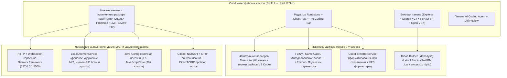

<div align="center">
  <p>
    
  </p>
  <p><strong>Нативный редактор кода, удалённая рабочая станция и AI IDE для iOS и iPadOS</strong></p>

  <p>
    <a href="README.md">Tiếng Việt</a> |
    <a href="README.en.md">English</a> |
    <a href="README.zh-CN.md">简体中文</a> |
    <a href="README.ja.md">日本語</a> |
    <a href="README.ko.md">한국어</a> |
    <strong>Русский</strong> |
    <a href="README.es.md">Español</a>
  </p>

  <p>
    <a href="https://github.com/userlethekhoi/3012/actions/workflows/build-ipa.yml">
      
    </a>
    <a href="https://github.com/userlethekhoi/3012/releases/latest">
      
    </a>
    <a href="https://github.com/userlethekhoi/3012/releases/latest/download/3012-Unsigned.ipa">
      
    </a>
    
    
    <a href="LICENSE">
      
    </a>
  </p>
</div>

---

## Обзор

**3012** (`com.dev.app3012`) — нативная среда разработки (IDE) для **iOS 15.0+** и **iPadOS 15.0+**, написанная полностью на `SwiftUI` и `UIKit` без WebView или Electron, чтобы перенести рабочий процесс **VS Code** и **Cursor** на мобильные устройства без потери производительности.

В основе редактора лежит `Runestone` с **48 статически скомпилированными C/C++ парсерами `Tree-sitter`** для плавной прокрутки 120 Гц ProMotion. В приложение встроены локальный веб-сервер `localhost:5500`, **локальный фоновый демон 24/7 для ботов Telegram и скриптов**, сборщик **Theos Tweak** (`.deb`/`.dylib`), **xtool Studio** (сборка `.ipa` из SwiftPM и инъекция `.dylib` в Mach-O), терминал `SwiftTerm` (`xterm-256color`), **SSH/SFTP** клиент на базе `Citadel` и **AI Coding Agent** с просмотром diff-патчей.

---

## Загрузка и установка

Каждое обновление ветки `main` автоматически собирается в GitHub Actions на `macos-15` (Xcode 16+) и публикуется в разделе **Releases** как **`3012-Unsigned.ipa`** (с ad-hoc подписью для прямой установки через **TrollStore на iOS 15/16+** или через личные `.p12`-сертификаты).

- **Прямая ссылка на последнюю сборку:** [**3012-Unsigned.ipa (Latest Release)**](https://github.com/userlethekhoi/3012/releases/latest/download/3012-Unsigned.ipa)
- **Все релизы и контрольные суммы SHA-256:** [GitHub Releases](https://github.com/userlethekhoi/3012/releases)

### Способы установки (TrollStore / `.p12` / Sideload)

| Инструмент | Требования | Порядок установки |
| :--- | :--- | :--- |
| **TrollStore** | iOS 15.0+ – 17.0 с поддержкой CoreTrust | Откройте `3012-Unsigned.ipa` напрямую в TrollStore для постоянной установки без переподписи. |
| **Feather / ESign / GBox** | Личный сертификат `.p12` + `.mobileprovision` | Импортируйте сертификат, выберите `3012-Unsigned.ipa` и нажмите **Sign & Install**. |
| **AltStore / SideStore** | Личный Apple ID (бесплатный или платный) | Откройте `3012-Unsigned.ipa` через **My Apps (+)** для автоматической подписи и продления. |
| **Sideloadly (macOS / Windows)** | Apple ID или сертификат разработчика | Перетащите `3012-Unsigned.ipa` в Sideloadly и установите по USB или Wi-Fi. |

---

## Архитектура системы



---

## Основные возможности

### 1. Нативный редактор 120 Гц, 64 языка, вкладки VS Code и изменяемые разделители
- **48 скомпилированных парсеров `Tree-sitter`** с 3-уровневым определением языка (`Dockerfile`, `Makefile`, `Package.swift`, `xtool.yml`, `Tweak.x`, более **145 расширений** и анализ `shebang`), а также **иконки файлов в стиле VS Code Seti** в дереве проекта и вкладках.
- Поддержка 64 языков: системные (`C`, `C++`, `Rust`, `Go`, `Zig`, `Objective-C`, `Logos`), веб (`HTML`, `CSS`, `SCSS`, `JS`, `TS`, `TSX`, `Vue`, `Svelte`, `Astro`), мобильные (`Swift`, `Dart`, `Kotlin`, `Java`), скриптовые (`Python`, `PHP`, `Ruby`, `Lua`, `Elixir`) и конфиги (`SQL`, `JSON`, `YAML`, `TOML`, `Makefile`, `CMake`, `Terraform`).
- **Панель вкладок VS Code:** закрепление вкладок (`Pin Tab`), повторное открытие закрытой вкладки (`Cmd + Shift + T`), открытие отдельных внешних файлов, папок и `.zip`-архивов из приложения **Файлы** с двусторонней синхронизацией через `NSFileCoordinator`.
- **Изменяемые разделённые области (Split Views):** перетаскивание границ для нижней консоли/предпросмотра, правой панели AI Agent и режима Markdown + Mermaid (двойное нажатие сбрасывает пропорции).
- **Pro Coding Accessory Bar:** двухрядная панель над клавиатурой с тактильным **Trackpad** для точного перемещения курсора и выделения, клавишами стрелок с автоповтором при удержании, **Flick Keys** для скобок и операторов, клавишей `Tab` для принятия Ghost Text, быстрыми Undo/Redo/Copy/Paste и **Pinch-to-Zoom**.

### 2. Smart IntelliSense, Ghost Text, автоформатирование и диагностика
- **Автодополнение уровня VS Code (`CodeIntelligenceService`):** Fuzzy-поиск и сокращения CamelCase/`snake_case` (`gEBI` -> `getElementById`, `umap` -> `std::unordered_map`), мгновенные подсказки после `.`, `->`, `::`, `#include <`, контекст `<style>`/`<script>` внутри HTML/Vue/Svelte, встроенный **Emmet**, полупрозрачный **Ghost Completion**, поддержка **Theos Logos** (`%hook`, `%orig`) и **`xtool.yml`/`Package.swift`**, а также **Symbol Outline** и встроенный **Find & Replace** (`Cmd + F`).
- **Автоформатирование (`CodeFormatterService`):** Format-on-Save / Format-on-Run (`Cmd + Shift + F`) через форматтеры на VPS (`clang-format`, `gofmt`, `rustfmt`, `black`, `prettier`) или локальный офлайн-форматтер с сохранением табуляции `\t` для `Makefile` и `Go`.
- **Inline Diagnostics:** подсветка строк с ошибками прямо в редакторе, синхронизация со вкладкой **Problems** и быстрая передача в AI Agent.

### 3. Цветовые статусы файлов как в VS Code (`U` / `A` / `M` / `D`)
| Метка | Статус | Цвет | Значение |
| :---: | :--- | :--- | :--- |
| **`U`** | Untracked | Зелёный (`#73C991`) | Новый файл в рабочей области. |
| **`A`** | Added Code | Зелёный (`#73C991`) | В существующий файл добавлены новые строки или блоки кода. |
| **`M`** | Modified | Янтарный (`#E2C08D`) | Файл изменён на месте без добавления новых строк. |
| **`D`** | Deleted | Красный (`#F14C4C` + зачёркивание) | Удалённый файл остаётся видимым на прежнем месте с кнопкой **Восстановить**. |

### 4. Встроенный Live Server (`127.0.0.1:5500`) и фоновый демон 24/7 на устройстве
- **Live Server `:5500` и мобильный F12 DevTools:** HTTP + WebSocket сервер на `Network.framework` с автоматическим **Hot-Reload** при сохранении `.html`/`.css`/`.js`, просмотром в **Safari** или Split Preview с перехватом `console.log`/`error`, выполнением JS и эмуляцией экранов (`390px`, `768px`, `1280px`).
- **Локальный демон 24/7 и Telegram-бот (`LocalDaemonService`):** удерживает `localhost:5500`, SSH-сессии и фоновые скрипты в активном состоянии при выключенном экране или переключении приложений (`AVAudioSession` + `beginBackgroundTask` + `NWPathMonitor`). Включает генератор Telegram-бота в 1 касание с `.env`, запуск `.js`-скриптов (`fetch`, `setInterval`, `fs`, `process.deviceStatus()`), адаптер для Python-ботов, управление процессами по `PID`, автоперезапуск при сбоях и просмотр логов в реальном времени.

### 5. Разработка под iOS на устройстве: `xtool` Studio и сборка Theos (`.deb` / `.dylib`)
- **xtool Studio (`XtoolBuildService`):** шаблоны SwiftPM + `xtool.yml`, двусторонняя синхронизация `Package.swift` ⇄ `xtool.yml`, сборка через SSH VPS или GitHub Actions, а также **локальный инъектор `.dylib` в `.ipa`** (распаковка `.ipa`, добавление `.dylib` в `Frameworks/`, патч заголовка Mach-O 64-bit / Fat `LC_LOAD_DYLIB`, изменение `CFBundleIdentifier` и перепаковка без Mac).
- **Theos Tweak & Mod Menu Builder (`TheosBuildService`):** генерация **Logos Tweak** и **Floating Mod Menu HUD**, автозаполнение `_FILES` в `Makefile`, поддержка **`rootless` / `roothide` / `rootful`** и сборка в 3 режимах (изолированный Docker-сервер, личный SSH VPS или экспорт `.zip` с GitHub Actions).

### 6. Zero-Config запуск, терминал `SwiftTerm` и удалённый SSH / SFTP (`Citadel`)
- **Zero-Config Run (`Cmd + R`):** запуск более **30 языков** без ручной настройки или автоматическое использование компиляторов на подключённом VPS.
- **`SwiftTerm` (`xterm-256color`):** офлайн-оболочка с UNIX и Windows-командами (`ls`/`dir`, `cd`, `cat`, `grep`, `tree`, `git`, `zip`/`unzip`, `curl`, `bg`, `ps`, `logs`, `keepalive`, `xtool`, `claude`, `opencode`), автоматически переключающаяся в полноценный **Linux SSH PTY** (`vim`, `tmux`, `htop`, `pip3`, `gcc`, `gdb`) при подключении к серверу.
- **SSH, SFTP и проброс портов:** хранение ключей и паролей в **iOS Keychain** (с резервным хранилищем для установок TrollStore без entitlement), генерация ключей **Ed25519**, редактирование файлов по SFTP с автозагрузкой при сохранении, установка toolchain на VPS в 1 клик и **Local Port Forwarding (`localhost:<port>` ⇄ `VPS:<port>`)**.

### 7. AI Coding Agent, Theme Studio, Open VSX и 7 языков интерфейса
- **Настраиваемый AI Coding Agent:** поддержка OpenAI, Anthropic Claude, Google Gemini, DeepSeek, OpenRouter, xAI Grok, Groq, Mistral, Qwen, Z.ai GLM, локальных **Ollama / LM Studio** и **Apple On-Device** (iOS 26+); потоковый вывод SSE, обновление моделей через `/models` и **Diff Preview (`Accept & Save` / `Reject`)**.
- **Theme Studio и Open VSX (`.vsix`):** 14+ тем оформления, редактор цветов синтаксиса и установка тем/сниппетов `.vsix` напрямую из **Open VSX**.
- **7 языков интерфейса:** `Tiếng Việt`, `English`, `简体中文`, `日本語`, `한국어`, `Русский`, `Español`.

---

## Конфиденциальность

- **Без телеметрии:** приложение не содержит аналитики, трекеров, рекламы и промежуточных серверов.
- **Локальные учётные данные:** API-ключи, пароли VPS, SSH-ключи и токены GitHub хранятся только на устройстве в **iOS Keychain** (или изолированной области песочницы).

---

## Горячие клавиши аппаратной клавиатуры

| Комбинация | Действие |
| :--- | :--- |
| `Cmd + S` | Сохранить файл, отформатировать (если включено) и создать снимок в истории |
| `Cmd + Shift + F` | Отформатировать текущий документ по правилам языка |
| `Cmd + R` | Умный запуск (`Live Server` / `Sandbox` / `Theos` / `xtool` / `SSH`) |
| `Cmd + P` | Палитра команд и быстрый переход к файлу |
| `Cmd + F` / `Cmd + G` | Поиск и замена / Следующее совпадение (`Ctrl + G`: переход к строке) |
| `Cmd + /` | Закомментировать / раскомментировать строку |
| `Cmd + N` / `Cmd + O` | Создать файл / Открыть файл из «Файлов» |
| `Cmd + W` / `Cmd + Shift + T` | Закрыть вкладку / Восстановить закрытую вкладку |
| `Cmd + B` / `Cmd + I` / `Cmd + J` | Скрыть или показать левую панель / AI Agent / нижний терминал |
| `Opt + ↑` / `Opt + ↓` | Переместить строку или блок вверх / вниз |
| `Tab` | Принять подсказку `Smart IntelliSense` или `Ghost Completion` |

---

## Сборка из исходников

Конфигурация таргета и зависимости SPM описаны в [`project.yml`](project.yml) для **XcodeGen**.

```bash
git clone https://github.com/userlethekhoi/3012.git
cd 3012
xcodegen generate
xcodebuild -resolvePackageDependencies -project App3012.xcodeproj -scheme App3012

xcodebuild build \
  -project App3012.xcodeproj \
  -scheme App3012 \
  -configuration Release \
  -sdk iphoneos \
  -derivedDataPath build \
  IPHONEOS_DEPLOYMENT_TARGET=15.0 \
  CODE_SIGN_IDENTITY="" \
  CODE_SIGNING_REQUIRED=NO \
  CODE_SIGNING_ALLOWED=NO \
  AD_HOC_CODE_SIGNING_ALLOWED=YES

mkdir -p Payload
cp -R build/Build/Products/Release-iphoneos/3012.app Payload/
codesign --force --deep --sign - --timestamp=none Payload/3012.app
zip -qry 3012-Unsigned.ipa Payload
```

---

## Авторские права и лицензия (GNU AGPLv3)

**Copyright (c) 2026 Le The Khoi (GitHub: [@userlethekhoi](https://github.com/userlethekhoi) • Telegram: [@coder_009](https://t.me/coder_009)).**

Исходный код, архитектура и визуальные материалы **3012** распространяются под лицензией [**GNU Affero General Public License v3.0 (AGPL-3.0)**](LICENSE). При создании форков, модификаций, пересборке `.ipa` или предоставлении сетевого доступа к изменённой версии (раздел 13 AGPL-3.0) обязательно сохранять уведомление об авторстве и файл [`LICENSE`](LICENSE), а также **полностью публиковать исходный код под той же лицензией `AGPL-3.0`**.
