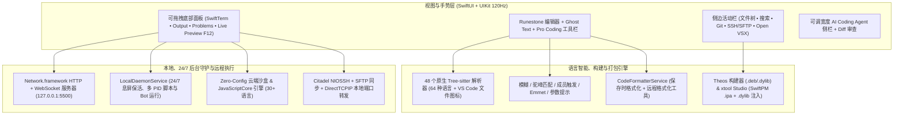

<div align="center">
  <p>
    
  </p>
  <p><strong>iOS 与 iPadOS 原生代码编辑器、远程开发工作站及 AI 编程 IDE</strong></p>

  <p>
    <a href="README.md">Tiếng Việt</a> |
    <a href="README.en.md">English</a> |
    <strong>简体中文</strong> |
    <a href="README.ja.md">日本語</a> |
    <a href="README.ko.md">한국어</a> |
    <a href="README.ru.md">Русский</a> |
    <a href="README.es.md">Español</a>
  </p>

  <p>
    <a href="https://github.com/userlethekhoi/3012/actions/workflows/build-ipa.yml">
      
    </a>
    <a href="https://github.com/userlethekhoi/3012/releases/latest">
      
    </a>
    <a href="https://github.com/userlethekhoi/3012/releases/latest/download/3012-Unsigned.ipa">
      
    </a>
    
    
    <a href="LICENSE">
      
    </a>
  </p>
</div>

---

## 项目简介

**3012**（`com.dev.app3012`）是一款专为 **iOS 15.0+** 和 **iPadOS 15.0+** 打造的 100% 原生集成开发环境（IDE），基于 `SwiftUI` 与 `UIKit` 构建，在移动端还原 **VS Code** 与 **Cursor** 的工作流，完全摆脱 WebView/Electron 带来的卡顿与功耗。

编辑器核心采用 `Runestone` 并内置 **48 个静态编译的 C/C++ `Tree-sitter` 语法解析器**，支持 120Hz ProMotion 流畅滚动；同时集成 `localhost:5500` 本地 Web 服务器、**本机 24/7 后台守护进程与 Telegram Bot 运行器**、**Theos Tweak**（`.deb`/`.dylib`）构建器、**xtool Studio**（SwiftPM `.ipa` 打包与本机 Mach-O `.dylib` 注入）、`SwiftTerm`（`xterm-256color`）终端、`Citadel` **SSH/SFTP** 远程开发以及带 Diff 审核面板的 **Coding Agent**。

---

## 下载与安装

`main` 分支的每次更新均由 GitHub Actions 在 `macos-15`（Xcode 16+）环境下自动编译，并在 **Releases** 中发布 **`3012-Unsigned.ipa`**（已附带 Ad-hoc 签名，可直接通过 **TrollStore** 在 iOS 15/16+ 永久安装，或使用个人 `.p12` 证书签名）。

- **直接下载最新版本：** [**3012-Unsigned.ipa (Latest Release)**](https://github.com/userlethekhoi/3012/releases/latest/download/3012-Unsigned.ipa)
- **全部历史版本与 SHA-256 校验：** [GitHub Releases](https://github.com/userlethekhoi/3012/releases)

### 安装方式（TrollStore / `.p12` / 自签）

| 安装工具 | 环境要求 | 操作步骤 |
| :--- | :--- | :--- |
| **TrollStore (巨魔商店)** | 支持 CoreTrust 的 iOS 15.0+ – 17.0 | 直接用 TrollStore 打开 `3012-Unsigned.ipa` 即可永久安装，无需续签。 |
| **Feather / ESign / GBox** | 个人 `.p12` 证书 + `.mobileprovision` | 导入证书后选择 `3012-Unsigned.ipa`，点击 **Sign & Install**。 |
| **AltStore / SideStore** | 个人 Apple ID（免费或开发者账号） | 在 **My Apps (+)** 中导入 `3012-Unsigned.ipa` 自动签名与续期。 |
| **Sideloadly (macOS / Windows)** | Apple ID 或开发者证书 | 将 `3012-Unsigned.ipa` 拖入 Sideloadly，通过 USB 或 Wi-Fi 安装。 |

---

## 系统架构



---

## 核心功能

### 1. 120Hz 原生编辑器、64 种语言与桌面级多标签/分屏
- **48 个原生编译 `Tree-sitter` 解析器**，支持三级语言识别（`Dockerfile`、`Makefile`、`Package.swift`、`xtool.yml`、`Tweak.x` 等特殊文件名 + **145+ 扩展名** + Shebang 内容识别），并在文件树与标签栏显示 **VS Code Seti 语言图标**。
- 涵盖 64 种语言：系统开发（`C`、`C++`、`Rust`、`Go`、`Zig`、`Objective-C`、`Logos`）、Web 前端（`HTML`、`CSS`、`SCSS`、`JS`、`TS`、`TSX`、`Vue`、`Svelte`、`Astro`）、移动与 JVM（`Swift`、`Dart`、`Kotlin`、`Java`）、脚本数据（`Python`、`PHP`、`Ruby`、`Lua`、`Elixir`）以及配置基础设施（`SQL`、`JSON`、`YAML`、`TOML`、`Makefile`、`CMake`、`Terraform`）。
- **独立 VS Code 标签栏：** 新文件置左，支持固定标签（`Pin Tab`）、恢复刚关闭的标签（`Cmd + Shift + T`），以及通过 iOS **文件** App 直接打开外部单文件、文件夹或 `.zip` 压缩包（自动解压并与 `NSFileCoordinator` 双向同步）。
- **自由拖拽分屏：** 底部控制台/预览、右侧 AI Agent 面板与 Markdown + Mermaid 分屏均支持拖拽调整尺寸（双击重置比例）。
- **Pro Coding 键盘扩展栏：** 双行键盘扩展条集成带震动反馈的 **Trackpad** 光标/选区滑动区、长按连发方向键、上滑输入括号/运算符的 **Flick Keys**、`Tab` 确认幽灵补全、一键撤销/重做/复制/粘贴以及 **双指捏合缩放字号**。

### 2. Smart IntelliSense、幽灵补全（Ghost Text）、自动格式化与实时纠错
- **VS Code 级智能提示（`CodeIntelligenceService`）：** 支持模糊子序列与驼峰/下划线缩写（如 `gEBI` -> `getElementById`、`umap` -> `std::unordered_map`）；输入 `.`、`->`、`::`、`#include <` 零延迟触发；在 HTML/Vue/Svelte 中自动识别 `<style>` CSS 与 `<script>` JS 上下文；内置 **Emmet**（`!`、`div.card`、`ul>li*3`）、行内浅色 **Ghost Completion**、**Theos Logos**（`%hook`、`%orig`）与 **`xtool.yml`/`Package.swift`** 专属提示，并配备 **Symbol Outline** 与行内查找替换（`Cmd + F`）。
- **自动代码格式化（`CodeFormatterService`）：** 支持保存/运行时自动格式化（`Cmd + Shift + F`），可联动远程 VPS 工具（`clang-format`、`gofmt`、`rustfmt`、`black`、`prettier`、`swift-format`）或本地内置格式化器（保留 `Makefile` 与 `Go` 的 `\t` 缩进）。
- **实时行内报错（`Inline Diagnostics`）：** 在编辑器内直接高亮语法错误并同步至 **Problems** 面板，支持一键跳转或交给 Coding Agent 修复。

### 3. VS Code 文件状态颜色标识（`U` / `A` / `M` / `D`）
| 标记 | 状态 | 颜色 | 含义 |
| :---: | :--- | :--- | :--- |
| **`U`** | Untracked | 绿色 (`#73C991`) | 工作区中新建的文件。 |
| **`A`** | Added Code | 绿色 (`#73C991`) | 在原有文件基础上新增了代码行或代码块。 |
| **`M`** | Modified | 琥珀黄 (`#E2C08D`) | 原地修改了内容但未新增行。 |
| **`D`** | Deleted | 红色 (`#F14C4C` + 删除线) | 已删除的文件，保留原路径可见并支持 **一键恢复**。 |

### 4. 内置 Live Server（`127.0.0.1:5500`）与本机 24/7 后台挂机运行器
- **Live Server `:5500` 与移动端 F12 DevTools：** 基于 `Network.framework` 的 HTTP + WebSocket 服务，保存 `.html`/`.css`/`.js` 即触发 **Hot-Reload**；可在 Safari 或分屏预览中实时查看，内置 `console` 日志捕获、JS Eval 与响应式视口切换（`390px` / `768px` / `1280px`）。
- **24/7 本机后台守护与 Telegram Bot（`LocalDaemonService`）：**
  - 通过 `AVAudioSession` 静音循环保活 + `beginBackgroundTask` + `NWPathMonitor`，在锁屏或切换应用后依然保持 `localhost:5500`、SSH PTY 会话与后台脚本不断线。
  - **一键创建 Telegram Bot**（自动配置 `.env`），支持直接运行 `.js` 守护脚本（`fetch`、`setInterval`、`fs`、`process.deviceStatus()` 读取电量与网络）及 Python Bot 适配器，提供多 `PID` 管理、断网自动重启与实时控制台日志。

### 5. 本机 iOS 开发：`xtool` Studio 与 Theos Tweak 构建器（`.deb` / `.dylib`）
- **xtool Studio（`XtoolBuildService`）：** 一键生成 SwiftPM + `xtool.yml` 项目模板（`SwiftUI App`、`SwiftUI App + Widget`、`Host App + .dylib`），双向同步 `Package.swift` ⇄ `xtool.yml`，支持通过 SSH VPS 或 GitHub Actions 编译打包。
- **本机 Mach-O `.dylib` 注入器：** 直接在 iPhone/iPad 上解包 `.ipa`、将 `.dylib` 注入 `Payload/<App>.app/Frameworks/`、原生修补 64 位 / Fat Mach-O 头部（`LC_LOAD_DYLIB`）、修改 `CFBundleIdentifier` / `CFBundleDisplayName` 并重打包为未签名 `.ipa`。
- **Theos Tweak & Mod Menu 构建器（`TheosBuildService`）：** 一键生成 **Logos Tweak** 或 **悬浮 Mod Menu HUD**，自动扫描源文件填充 `Makefile`（`_FILES`），完整支持 **`rootless` / `roothide` / `rootful`**，支持 Docker 隔离构建服务器、个人 SSH VPS 或离线 `.zip` + GitHub Actions 三种编译方式。

### 6. Zero-Config 一键运行、`SwiftTerm` 与 SSH / SFTP 远程工作站
- **Zero-Config Run（`Cmd + R`）：** 无需手动配置编译器即可运行 **30+ 种语言**（C、C++20、Rust、Go、Java、C#、Python、Swift、Zig、PHP、Ruby、Lua、SQL 等），连接 SSH VPS 时自动优先使用服务器真实编译环境。
- **`SwiftTerm` (`xterm-256color`) 终端：** 离线时运行内置 UNIX/Windows 混合 Shell（`ls`/`dir`、`cd`、`cat`、`grep`、`tree`、`git`、`zip`/`unzip`、`curl`、`bg`、`ps`、`logs`、`keepalive`、`xtool`、`claude`、`opencode`）；连接 VPS 后自动切换为完整 **Linux SSH PTY**（`vim`、`tmux`、`htop`、`pip3`、`gcc`、`gdb`）。
- **SSH / SFTP 与端口转发：** 密码与密钥存入 **iOS Keychain**（在无 Keychain 权限的 TrollStore 环境下自动切换沙盒安全存储），支持一键生成 **Ed25519** 密钥、SFTP 目录挂载与保存自动回传、一键部署 VPS 编译工具链及 **SSH 本地端口转发（`localhost:<port>` ⇄ `VPS:<port>`）**。

### 7. Agentic Coding Assistant、Theme Studio、Open VSX 与 7 国语言
- **自定义 AI Coding Agent：** 由用户自行配置 OpenAI、Claude、Gemini、DeepSeek、OpenRouter、xAI Grok、Groq、Mistral、Qwen、Z.ai GLM、局域网 **Ollama / LM Studio** 或 **Apple On-Device**（iOS 26+）；支持 SSE 实时流式输出、`/models` 自动发现最新模型及 **Diff Preview（`Accept & Save` / `Reject`）**。
- **Theme Studio & Open VSX（`.vsix`）：** 内置 14+ 明暗主题、自定义语法配色器，支持直接从 **Open VSX** 下载安装 `.vsix` 配色主题与代码片段。
- **7 种应用界面语言：** 应用内随时切换 `Tiếng Việt`、`English`、`简体中文`、`日本語`、`한국어`、`Русский`、`Español`。

---

## 隐私说明

- **零数据收集：** 3012 不含任何统计 SDK、广告或行为追踪，也不架设中转代理服务器。
- **凭据本地保存：** API Key、VPS 密码、SSH 私钥与 GitHub Token 仅保存在本机 **iOS Keychain**（或无权限环境下的应用沙盒存储）中。
- **外部请求：** 仅在使用在线 AI 服务或社区 Theos 构建服务器时直接向目标服务器发起请求，且首次使用社区构建服务器前会弹窗请求用户确认。

---

## 外接键盘快捷键（Magic Keyboard / 蓝牙键盘）

| 快捷键 | 功能 |
| :--- | :--- |
| `Cmd + S` | 保存当前文件、自动格式化（如开启）并记录版本快照 |
| `Cmd + Shift + F` | 按当前文件语言格式化代码（`Format Document`） |
| `Cmd + R` | 智能运行当前文件或项目（`Live Server` / `Sandbox` / `Theos` / `xtool` / `SSH`） |
| `Cmd + P` | 打开命令面板与快速打开文件（`Command Palette`） |
| `Cmd + F` / `Cmd + G` | 打开行内查找替换 / 跳转到下一个匹配项（`Ctrl + G`：跳转到指定行） |
| `Cmd + /` | 切换当前行或选区注释 |
| `Cmd + N` / `Cmd + O` | 快速新建文件 / 从“文件”App 打开文件 |
| `Cmd + W` / `Cmd + Shift + T` | 关闭当前标签页 / 恢复最近关闭的标签页 |
| `Cmd + B` / `Cmd + I` / `Cmd + J` | 切换左侧栏 / 右侧 AI Agent / 底部终端面板 |
| `Opt + ↑` / `Opt + ↓` | 向上 / 向下移动当前行或选中代码块 |
| `Tab` | 采纳 `Smart IntelliSense` 或 `Ghost Completion` 补全 |

---

## 从源码编译（Build from Source）

项目的 Target、系统框架与 Swift Package Manager 依赖均声明在 [`project.yml`](project.yml) 中，通过 **XcodeGen** 生成工程。

### 环境要求
- macOS 15.0+ 与 **Xcode 16.0+**
- [**XcodeGen**](https://github.com/yonaskolb/XcodeGen)（`brew install xcodegen`）

### 编译 `3012-Unsigned.ipa`

```bash
git clone https://github.com/userlethekhoi/3012.git
cd 3012
xcodegen generate
xcodebuild -resolvePackageDependencies -project App3012.xcodeproj -scheme App3012

xcodebuild build \
  -project App3012.xcodeproj \
  -scheme App3012 \
  -configuration Release \
  -sdk iphoneos \
  -derivedDataPath build \
  IPHONEOS_DEPLOYMENT_TARGET=15.0 \
  CODE_SIGN_IDENTITY="" \
  CODE_SIGNING_REQUIRED=NO \
  CODE_SIGNING_ALLOWED=NO \
  AD_HOC_CODE_SIGNING_ALLOWED=YES

mkdir -p Payload
cp -R build/Build/Products/Release-iphoneos/3012.app Payload/
codesign --force --deep --sign - --timestamp=none Payload/3012.app
zip -qry 3012-Unsigned.ipa Payload
```

---

## 版权与开源协议（GNU AGPLv3）

**Copyright (c) 2026 Le The Khoi (GitHub: [@userlethekhoi](https://github.com/userlethekhoi) • Telegram: [@coder_009](https://t.me/coder_009)).**

**3012** 的全部源代码、系统架构及品牌视觉资产均遵循 [**GNU Affero General Public License v3.0 (AGPL-3.0)**](LICENSE) 发布。任何 Fork、二次修改、重新打包（`.ipa`）或通过网络提供服务（AGPL-3.0 第 13 条）的衍生项目，均须保留原始版权声明与 [`LICENSE`](LICENSE) 文件，并**完整公开全部对应源代码**且继续采用 `AGPL-3.0` 协议；禁止闭源商用或抹除原作者署名。
